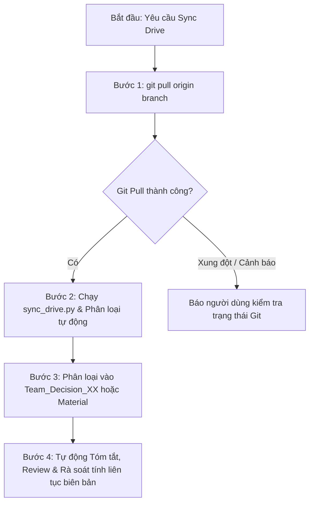

# DRIVE SYNC: QUY TRÌNH ĐỒNG BỘ GOOGLE DRIVE VÀ PHÂN LOẠI TÀI LIỆU

Kỹ năng này chuẩn hóa quy trình 2 bước: **Pull commit mới nhất từ GitHub** $\rightarrow$ **Kéo tài liệu/biên bản họp mới nhất từ Google Drive**, **tự động phân loại vào đúng thư mục con nghiệp vụ** và **tóm tắt review trực tiếp trên màn hình chat**.

---

## 🌟 1. Khi nào Kích hoạt Kỹ năng này?

AI tự động kích hoạt kỹ năng này khi:
1. Người dùng ra lệnh: *"sync drive"*, *"cập nhật drive"*, *"lấy tài liệu từ drive"*, *"kéo biên bản họp về"*.
2. Người dùng chuẩn bị bắt đầu phân tích biên bản họp mới hoặc tổng hợp tài liệu tuần: AI chủ động nhắc người dùng chạy luồng sync trước.
3. Người dùng hỏi cách để các thành viên trong nhóm đồng bộ tài liệu từ Drive về máy cá nhân.

---

## 🚀 2. Luồng Thực thi Chuẩn (Quy trình 4 Bước Bắt buộc)



### Chi tiết các bước thực hiện bằng lệnh:

1. **Bước 1: Kéo commit mới nhất từ GitHub**
   ```bash
   git pull origin main
   ```
   *(Hoặc branch hiện tại của repository)*

2. **Bước 2: Chạy script đồng bộ Google Drive**
   ```bash
   python3 .agents/scripts/sync_drive.py
   ```
   *(Hoặc chạy lệnh tiện ích gộp cả 2 bước: `./.agents/scripts/sync.sh`)*

3. **Bước 3: Tự động Tóm tắt & Review Trực Tiếp Ra Đoạn Chat (Chat Response Only)**
   > ⚠️ **Quy tắc bắt buộc:** Kết quả tóm tắt và review **phải được in trực tiếp ngay trong tin nhắn chat** để người dùng đọc nhanh tức thì. Tuyệt đối **không tạo thêm file báo cáo hay file `.md` phụ** gây rác thư mục.
   - Đọc nội dung file biên bản họp / tài liệu mới nhất vừa tải về.
   - Trình bày trực tiếp vào đoạn chat:
     * **Tóm tắt cốt lõi (Executive Summary):** Quyết định mới nhất của nhóm, phân công nhân sự, deadline và đề tài chốt.
     * **Review & Cảnh báo rủi ro (Critical Review):** Đánh giá tính khả thi trong 8 tuần Scrum, cảnh báo rủi ro kỹ thuật (Voice latency, Scraping, API limits) và rà soát bám sát yêu cầu GVTH.
     * **Việc cần làm tiếp theo (Action Items):** Các bước cụ thể nhóm cần thực hiện ngay.

4. **Bước 4: Kiểm tra Tính Liên Tục của Biên Bản Họp (Meeting Continuity & Gap Detection)**
   - Rà soát số thứ tự các biên bản họp (`Meeting_01`, `Meeting_02`, ...) và các Action Items đã cam kết trong biên bản trước.
   - **Phát hiện khoảng trống (Gap Detection):**
     * Ví dụ: `Meeting_01.md` đã ấn định cuộc họp ngày 14/10/2026 để chốt đề tài và phân công vai trò, nhưng kho tài liệu chỉ có kế hoạch triển khai ngày 15/10 mà thiếu mất `Meeting_02.md`.
   - **Hành động của AI:**
     * Bắt buộc cảnh báo người dùng ngay trong đoạn chat: *"Thiếu biên bản họp `Meeting_02.md` tương ứng với buổi họp ngày 14/10 đã lên lịch"*.
     * Đề xuất hỗ trợ người dùng tạo và chuẩn hóa ngay file `Meeting_02.md` dựa trên các quyết định và kế hoạch thực tế (`HireUS_Implementation_Plan.md`) để hoàn thiện hồ sơ đồ án nộp giảng viên.

5. **Bước 5: Trích Dẫn Nguồn Đúng Chuẩn (Dual-Linking: Local Path + Google Drive Link)**
   - Khi biên soạn hoặc trích dẫn các tài liệu được đồng bộ từ Google Drive:
   - **BẮT BUỘC cung cấp liên kết kép (Dual-linking):**
     * Link nội bộ tương đối trong repo: `[HireUS_Implementation_Plan.md](./Material/HireUS_Implementation_Plan.md)` (để xem offline/Git).
     * Link Google Drive gốc trực tuyến: `[Xem trên Google Drive](https://drive.google.com/file/d/1s8uYv3yBGpx7TyCsTtIVSbNTrC8LbDbY/view)` kèm link folder Drive chung để giảng viên/đồng đội kiểm chứng bản gốc cloud.
   - Tuyệt đối không chỉ ghi tên file suông mà không trích dẫn link nguồn.

6. **Bước 6: Trung Thực Tuyệt Đối Với Dữ Liệu Gốc (Zero-Hallucination & Raw Fidelity)**
   > ⛔ **Cấm tuyệt đối:** Không tự ý suy diễn, không "bày vẽ" hoặc bịa đặt thêm các thông tin chưa có trong thực tế cuộc họp.
   - Khi convert biên bản họp từ ghi chép thô của người dùng:
     * **Giữ nguyên 100% nội dung nguyên bản:** Giữ đúng thời gian, danh sách ý tưởng từng thành viên nêu ra, các mốc deadline và quyết định thực tế.
     * **Không tự ý gán RACI hay bịa phân hệ kỹ thuật:** Nếu cuộc họp chỉ dừng lại ở việc chốt ý tưởng, không được tự ý gán vai trò RACI chi tiết hay vẽ ra 5 phân hệ nếu nhóm chưa họp bàn về điều đó.
     * **Chỉ chuẩn hóa hình thức:** Vai trò của AI là định dạng lại văn bản thành Markdown sạch đẹp (bảng biểu, danh sách), hoàn toàn không được bóp méo hay thêm thắt nội dung.

---

## 🗂️ 3. Quy tắc Phân loại Thư mục Tự động (Auto-Classification)

Khi tải tài liệu từ Drive về, **tuyệt đối không để file nằm lộn xộn ở thư mục gốc tuần (`docs/WeekXX/`)**. Hệ thống phân định rạch ròi giữa tài liệu của Thầy và tài liệu của Nhóm:

| Phân vùng tài liệu | Mục đích sử dụng | Từ khóa nhận diện | Thư mục đích phân loại | Ví dụ minh họa |
| :--- | :--- | :--- | :--- | :--- |
| **Biên bản họp nhóm** | Ghi nhận nội dung, quyết định và phân công của các buổi họp nhóm | `meeting`, `bien_ban`, `hop_nhom` | **`docs/WeekXX/Team_Decision/`** | [Meeting_01.md](../../docs/Week01/Team_Decision/Meeting_01.md)<br>[Meeting_02.md](../../docs/Week01/Team_Decision/Meeting_02.md) |
| **Tài liệu/Kế hoạch nhóm** | Kế hoạch triển khai, tài liệu đặc tả, bản nháp đề xuất do nhóm tự làm | `hireus`, `jobseeker`, `plan`, `proposal`, `decision` | **`docs/WeekXX/Team_Decision/Material/`** | [HireUS_Implementation_Plan.md](../../docs/Week01/Team_Decision/Material/HireUS_Implementation_Plan.md)<br>[HireUS_Implementation_Plan.html](../../docs/Week01/Team_Decision/Material/HireUS_Implementation_Plan.html) |
| **Tài liệu từ Giảng viên** | **CHỈ DÀNH RIÊNG** cho thông báo, template, đề cương hướng dẫn từ Thầy nndkhoa | `material`, `thong_bao`, `template`, `tai_lieu` | **`docs/WeekXX/Material/`** | [Template#0-ProjectProposal-2022.pdf](../../docs/Week01/Material/Template%230-ProjectProposal-2022.pdf)<br>[Thông_báo_1.md](../../docs/Week01/Material/Thông_báo_1.md) |
| **Bài toán mẫu** | Các bài toán đặc tả mẫu do môn học cung cấp để tham khảo | `problem`, `example`, `bai_toan`, `de_bai` | **`docs/WeekXX/Problem_example/`** | [Problem_example_01.md](../../docs/Week01/Problem_example/Problem_example_01.md) |

---

## 🚫 4. Quy tắc Nghiêm cấm File Rác `.sync_manifest.json` trong `docs/`

- **Bản chất file:** `.sync_manifest.json` là file cache kỹ thuật nội bộ của script (ghi nhớ hash SHA256 và kích thước file để bỏ qua file đã tải).
- **Quy định bất di bất dịch:** 
  * File `.sync_manifest.json` **TUYỆT ĐỐI KHÔNG ĐƯỢC XUẤT HIỆN** trong thư mục `docs/` hoặc các thư mục tuần (`docs/Week01/`, `docs/Week02/`...).
  * Vị trí lưu trữ duy nhất được phép: **Ẩn bên trong `.agents/scripts/.sync_manifest.json`**.
  * File này phải được cấu hình trong [.gitignore](../../.gitignore) để Git không theo dõi.
  * Thư mục `docs/` phải luôn tinh gọn, sạch sẽ, chỉ phục vụ lưu trữ tài liệu đồ án của nhóm.

---

## 👥 5. Hướng dẫn dành cho các Thành viên trong Nhóm (Non-AI)

Các thành viên khác trong nhóm chỉ cần mở terminal tại thư mục gốc của dự án và chạy:

```bash
# Cách 1: Dùng script tiện ích (Khuyên dùng)
./.agents/scripts/sync.sh

# Cách 2: Dùng lệnh Python
python3 .agents/scripts/sync_drive.py --pull
```

> **Ghi chú:** Script sử dụng thư viện chuẩn của Python (`urllib`), **không cần cài thêm bất kỳ thư viện ngoài (pip)** nào, hoạt động ngay lập tức trên mọi hệ điều hành (macOS, Windows, Linux).
