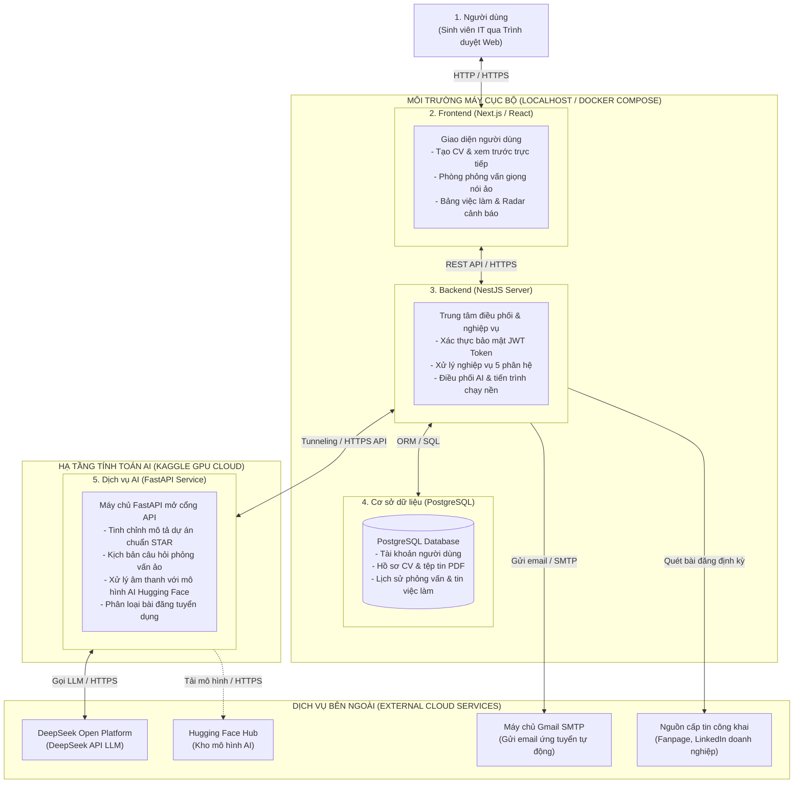

# NHẬP MÔN CÔNG NGHỆ PHẦN MỀM
## PROJECT PROPOSAL: NỀN TẢNG TỐI ƯU HỒ SƠ, MÔ PHỎNG PHỎNG VẤN KỸ THUẬT & SĂN VIỆC LÀM CHO SINH VIÊN IT (HIREUS)

> **Môn:** Nhập môn Công nghệ Phần mềm (Introduction to Software Engineering)

> **Trường:** Đại học Khoa học Tự nhiên, ĐHQG-HCM

> **Giảng viên lý thuyết (GVLT):** Thầy Phạm Minh Tuấn

> **Giảng viên thực hành (GVTH):** Thầy Nguyễn Ngô Duy Khoa

> **Nhóm thực hiện:** Nhóm sinh viên 4 thành viên

> **Mô hình phát triển:** Scrum (Agile) triển khai trong 8 tuần

---

## 1. BẢNG ĐÁNH GIÁ THÀNH VIÊN

| STT | MSSV | Họ và Tên | % Đóng góp (Tối đa 100%) | Chữ ký |
| :---: | :---: | :--- | :---: | :---: |
| 1 | *<MSSV1>* | **Lê Tấn Dũng** | 100% | *(Ký khi nộp)* |
| 2 | *<MSSV2>* | **Võ Nguyễn Việt Hoàng** | 100% | *(Ký khi nộp)* |
| 3 | *<MSSV3>* | **Võ Minh Khoa** | 100% | *(Ký khi nộp)* |
| 4 | *<MSSV4>* | **Đỗ Chí Cao** | 100% | *(Ký khi nộp)* |

---

## 2. PHÁT BIỂU BÀI TOÁN SƠ LƯỢC

**HireUS** là hệ thống ứng dụng web giúp kết nối sinh viên ngành Công nghệ Thông tin với các cơ hội việc làm thực tập sinh và sinh viên mới tốt nghiệp. Hệ thống hỗ trợ sinh viên tự chuẩn hóa hồ sơ ứng tuyển đúng chuẩn công nghiệp, tham gia các buổi phỏng vấn thử nghiệm bằng giọng nói với trí tuệ nhân tạo, đối chiếu năng lực hiện tại với yêu cầu của thị trường lao động, tự động hóa quy trình nộp hồ sơ xin việc đến các nhà tuyển dụng và theo dõi các đợt mở đơn tuyển dụng sớm từ mạng xã hội.

Khi cần tạo hồ sơ xin việc, đầu tiên sinh viên cung cấp các thông tin cá nhân và năng lực chuyên môn: họ và tên, địa chỉ email, số điện thoại, liên kết trang cá nhân (LinkedIn, GitHub), mục tiêu nghề nghiệp, thông tin học vấn gồm trường, chuyên ngành, điểm GPA tích lũy và chứng chỉ chuyên môn, danh mục kỹ năng kỹ thuật gồm ngôn ngữ lập trình, framework, cơ sở dữ liệu và công cụ phát triển, cùng danh sách các dự án kỹ thuật đã từng tham gia. Thông tin này cần chính xác và trung thực để nhà tuyển dụng đánh giá đúng năng lực. Đối với mỗi dự án, sinh viên cần cung cấp: tên dự án, đường dẫn mã nguồn, vai trò đảm nhận, thời gian thực hiện, công nghệ sử dụng và các gạch đầu dòng mô tả những đóng góp cụ thể. Kế tiếp, để tối ưu hóa nội dung, sinh viên có thể kích hoạt trợ lý SeekerBot. Trợ lý này sẽ phân tích từng câu mô tả dự án và tự động gợi ý viết lại theo cấu trúc định lượng kết quả với số liệu đo lường cụ thể và phương pháp STAR gồm bối cảnh, nhiệm vụ, hành động và kết quả. Sinh viên có thể xem bản so sánh trước và sau khi gợi ý để lựa chọn áp dụng hoặc tự chỉnh sửa lại theo ý muốn. Về hình thức trình bày, hệ thống tự động sắp xếp dữ liệu theo bố cục đơn cột chuẩn ATS nhằm tránh lỗi đọc văn bản khi các doanh nghiệp dùng phần mềm tự động quét hồ sơ. Sinh viên có thể tùy biến thứ tự hiển thị các khối nội dung và xem trước bản in theo thời gian thực. Sau khi hoàn thiện, sinh viên có thể xuất bản hồ sơ ra tệp tin định dạng PDF với lớp văn bản chuẩn 100% cho phép chọn và sao chép dữ liệu chính xác, hoặc lưu lại thành các mẫu hồ sơ khác nhau trong tài khoản của mình.

Khi cần rèn luyện kỹ năng phỏng vấn chuyên môn, đầu tiên sinh viên thiết lập cấu hình phòng phỏng vấn ảo: lựa chọn vị trí ứng tuyển như Frontend, Backend, Fullstack hoặc AI/Data, chọn cấp độ thực tập sinh hoặc fresher, ngôn ngữ phỏng vấn bằng tiếng Việt hoặc tiếng Anh, và chọn gói nội dung phỏng vấn gồm kiến thức nền tảng cốt lõi, tư duy thuật toán hoặc giải quyết tình huống kỹ thuật thực tế. Kế tiếp, hệ thống kiểm tra kết nối microphone và loa hoặc tai nghe của thiết bị người dùng trước khi bắt đầu. Trong phòng phỏng vấn, trí tuệ nhân tạo trong vai trò người phỏng vấn kỹ thuật AI Tech Lead sẽ phát câu hỏi trực tiếp bằng giọng nói tự nhiên thông qua hệ thống âm thanh. Mỗi câu hỏi hiển thị kèm đồng hồ đếm ngược thời gian trả lời tối đa 2 phút cho mỗi câu. Sinh viên trả lời bằng lời nói trực tiếp thông qua microphone. Hệ thống sẽ nhận dạng âm thanh tức thời, chuyển thành văn bản và phân tích câu trả lời của ứng viên. Dựa trên nội dung sinh viên vừa trình bày, hệ thống sẽ linh hoạt đưa ra câu hỏi phụ hoặc hỏi sâu thêm vào các từ khóa kỹ thuật liên quan, đảm bảo tính liên tục và độ trễ thấp phù hợp cho phản xạ đối thoại của buổi phỏng vấn. Sinh viên có quyền yêu cầu người phỏng vấn "nhắc lại câu hỏi" hoặc "gợi ý định hướng trả lời" tối đa 2 lần trong một buổi. Mỗi phiên phỏng vấn kéo dài từ 5 đến 7 câu hỏi. Khi hoàn thành tất cả câu hỏi, hệ thống chấm điểm và xuất bản báo cáo đánh giá năng lực chi tiết theo thang điểm 100 dựa trên 3 tiêu chí: độ chính xác kiến thức nền tảng, tư duy xử lý vấn đề, và khả năng diễn đạt chuyên môn, kèm theo nhận xét chi tiết ưu/khuyết điểm và gợi ý câu trả lời chuẩn cho từng câu hỏi.

Về phía tìm kiếm cơ hội việc làm, hệ thống cung cấp danh mục các vị trí tuyển dụng thực tập sinh và fresher được thu thập từ các kênh tuyển dụng uy tín. Sinh viên có thể tìm kiếm việc làm theo các tiêu chí: chức danh công việc, địa điểm làm việc như TP. Hồ Chí Minh, Hà Nội, Đà Nẵng hoặc làm việc từ xa, và mức hỗ trợ hoặc lương. Khi sinh viên bấm xem chi tiết một bản mô tả công việc JD, hệ thống tự động bóc tách các yêu cầu kỹ thuật và đối chiếu với hồ sơ CV hiện tại của sinh viên để tính toán điểm tương thích năng lực Match Score từ 0% đến 100%. Đồng thời, hệ thống hiển thị bảng phân tích khoảng cách kỹ năng gồm hai danh sách: các kỹ năng sinh viên đã đáp ứng được đánh dấu màu xanh và các kỹ năng nhà tuyển dụng yêu cầu nhưng sinh viên còn thiếu được đánh dấu màu đỏ kèm theo gợi ý từ khóa tài liệu học tập để sinh viên chủ động trau dồi. Khi sinh viên quyết định nộp đơn ứng tuyển cho công việc đã chọn, hệ thống hỗ trợ quy trình gửi hồ sơ tự động. Đầu tiên, hệ thống trích xuất địa chỉ email nhận hồ sơ từ bản mô tả công việc. Kế tiếp, hệ thống tự động soạn thảo thư ứng tuyển cá nhân hóa bám sát các yêu cầu nổi bật của công việc và gắn kết với thế mạnh của sinh viên. Sinh viên có thể đọc lại, chỉnh sửa tiêu đề email và nội dung bức thư theo ý mình, kiểm tra lại tệp đính kèm CV PDF. Sau khi sinh viên bấm xác nhận gửi, hệ thống sẽ gửi trực tiếp email đến nhà tuyển dụng qua giao thức SMTP và ghi nhận trạng thái vào nhật ký ứng tuyển. Để phòng ngừa hành vi gửi thư rác, mỗi tài khoản sinh viên bị giới hạn gửi tối đa 10 email ứng tuyển tự động trong một ngày.

Để sinh viên không bỏ lỡ các kỳ tuyển dụng lớn từ các tập đoàn công nghệ như VNG, Bosch, NAB, FPT hay Viettel, hệ thống cung cấp công cụ Radar theo dõi thông tin tuyển dụng từ mạng xã hội. Sinh viên có thể thiết lập danh sách các Fanpage Facebook hoặc trang LinkedIn doanh nghiệp mà mình muốn theo dõi bằng cách cung cấp đường dẫn URL của trang. Định kỳ 6 giờ một lần, hệ thống tự động quét các bài viết mới xuất hiện trên các trang này và dùng trí tuệ nhân tạo để phân loại nội dung. Hệ thống sẽ tự động loại bỏ các bài viết truyền thông nội bộ, chúc mừng sinh nhật, hoặc hoạt động phong trào, chỉ giữ lại các bài đăng thực sự mở đợt tuyển dụng sinh viên. Đối với các bài viết tuyển dụng được duyệt, hệ thống tự động bóc tách các thông tin chính: tên doanh nghiệp, tên chương trình tuyển dụng, vị trí tuyển, yêu cầu ứng viên, thời hạn nộp hồ sơ và liên kết dẫn đến biểu mẫu đăng ký gốc. Khi có thông tin đợt tuyển dụng mới, hệ thống sẽ gửi thông báo tức thời trên bảng điều khiển của sinh viên và gửi email thông báo tổng hợp, giúp sinh viên nắm bắt kịp thời để chuẩn bị nộp đơn trước hạn chót.

Toàn bộ quá trình từ lúc tạo CV, phỏng vấn thử đến lúc gửi hồ sơ ứng tuyển đều được thực hiện trực tuyến thông qua trình duyệt web trên máy tính có kết nối Internet. Để đảm bảo tính an toàn và bảo mật thông tin, sinh viên cần đăng ký tài khoản với bước xác thực qua email và đăng nhập trước khi sử dụng hệ thống. Mọi thông tin hồ sơ cá nhân, kết quả phỏng vấn và lịch sử ứng tuyển đều được mã hóa và lưu trữ an toàn trong cơ sở dữ liệu quan hệ PostgreSQL. Về phía client trên thiết bị người dùng, hệ thống yêu cầu trình duyệt web hiện đại có hỗ trợ HTML5, đồng thời máy tính phải được trang bị microphone và loa hoặc tai nghe hoạt động bình thường phục vụ tương tác âm thanh hai chiều. Phía máy chủ, hệ thống được phát triển trên nền tảng Node.js (NestJS), kết nối với môi trường Kaggle để triển khai các dịch vụ AI, tích hợp mô hình AI trên Hugging Face kết hợp DeepSeek API, cùng máy chủ gửi email SMTP. Toàn bộ quy trình phát triển và hoàn thiện phần mềm được nhóm quản lý theo mô hình Agile/Scrum trong thời hạn 8 tuần.

---

## 3. GIẢI PHÁP ĐỀ XUẤT

Nhằm giải quyết triệt để các bài toán và nhu cầu thực tế đã nêu ở Mục 2, nhóm đề xuất giải pháp hệ thống **HireUS** gồm 5 phân hệ phần mềm kết hợp chặt chẽ:

1. **Phân hệ 1:** Tạo CV chuẩn ATS & Trợ lý Cố vấn SeekerBot.
2. **Phân hệ 2:** Mô phỏng Phỏng vấn Kỹ thuật Giọng nói Thời gian thực (Voice Mock Interview).
3. **Phân hệ 3:** Hỗ trợ Ứng tuyển & Rải CV Tự động (Auto Job Dispatcher).
4. **Phân hệ 4:** Tổng hợp Việc làm & Đối sánh Năng lực (Job Matching & Skill Gap Analysis).
5. **Phân hệ 5:** Radar Săn tin Tuyển dụng Sớm từ Mạng xã hội (Social Early Recruitment Radar).

### 3.1. Phần mềm

#### 3.1.1. Danh sách các chức năng phần mềm

| Nhu cầu | Yêu cầu |
| :--- | :--- |
| Là sinh viên IT, tôi muốn tạo hồ sơ trên biểu mẫu nhập liệu có cấu trúc phân định rõ ràng và xem trước trực tiếp theo chuẩn ATS để CV không bị máy quét tự động loại bỏ. | **Trình tạo CV chuẩn ATS:** Form nhập liệu đa khối (Kỹ năng, Dự án, Học vấn...), xem trước trực tiếp (Live Preview) bố cục đơn cột chuẩn mực, hỗ trợ xuất bản tệp PDF có text layer 100%. |
| Là sinh viên IT, tôi muốn nhận được gợi ý viết lại phần mô tả dự án theo phương pháp định lượng và cấu trúc rõ ràng để làm nổi bật năng lực kỹ thuật của bản thân. | **Trợ lý cố vấn SeekerBot:** Phân tích câu mô tả dự án, tự động gợi ý chuẩn hóa theo công thức định lượng kết quả và chuẩn STAR, phản hồi nhanh chóng và hỗ trợ so sánh kết quả trực quan. |
| Là sinh viên IT, tôi muốn tham gia phòng phỏng vấn kỹ thuật 1:1 bằng giọng nói với AI Tech Lead để rèn luyện phản xạ trả lời câu hỏi chuyên môn chân thực như phỏng vấn thật. | **Phỏng vấn kỹ thuật giọng nói:** Tương tác âm thanh hai chiều (Voice-to-Voice) qua micro và loa, phản hồi thoại nhanh và liên tục, kịch bản hỏi đáp chuyên sâu 5 - 7 câu theo từng vị trí (Frontend, Backend, AI...). |
| Là sinh viên IT sau khi phỏng vấn, tôi muốn nhận được báo cáo đánh giá chi tiết theo các tiêu chí kỹ thuật chuẩn mực để biết rõ lỗ hổng kiến thức và kịp thời ôn tập. | **Đánh giá năng lực kỹ thuật:** Tự động tổng hợp bảng điểm theo thang 100 dựa trên 3 tiêu chí (*Kiến thức nền tảng, Tư duy giải quyết vấn đề, Diễn đạt chuyên môn*), kèm nhận xét cụ thể và câu trả lời mẫu tham khảo. |
| Là sinh viên IT, tôi muốn hệ thống tự động so khớp CV của tôi với các việc làm đang mở để nhanh chóng chọn ra các công việc phù hợp nhất với năng lực hiện có. | **Đối soát năng lực (Job Matching):** Thu thập tin tuyển dụng Intern/Fresher, thuật toán đối sánh tính điểm tương thích Match Score (0% - 100%) giữa hồ sơ và JD, gắn nhãn kỹ năng đã đáp ứng và kỹ năng còn thiếu. |
| Là sinh viên IT, tôi muốn xem bảng phân tích kỹ năng thị trường đang đòi hỏi để có định hướng tự học bổ sung các công nghệ còn thiếu. | **Phân tích khoảng cách kỹ năng (Skill Gap):** Trực quan hóa danh mục công nghệ nhà tuyển dụng yêu cầu nhiều nhất cho vị trí mục tiêu, gợi ý lộ trình tự học và chủ đề dự án cần thực hiện. |
| Là sinh viên IT, tôi muốn tự động tạo Cover Letter bám sát bản mô tả công việc và gửi hồ sơ ứng tuyển qua email để tiết kiệm thời gian rải CV thủ công. | **Tự động gửi hồ sơ ứng tuyển:** Tự động trích xuất email nhà tuyển dụng từ JD, sinh Cover Letter cá nhân hóa, gửi kèm CV PDF trực tiếp qua giao thức SMTP, quy định gửi tối đa 10 email/ngày để đảm bảo an toàn. |
| Là sinh viên IT, tôi muốn theo dõi bài đăng tuyển dụng từ Fanpage/LinkedIn của các công ty công nghệ lớn để không bỏ lỡ đợt tuyển dụng sớm. | **Cấu hình Radar theo dõi mạng xã hội:** Cho phép người dùng thêm và quản lý danh sách đường dẫn (URL) Fanpage hoặc trang doanh nghiệp cần theo dõi, định kỳ quét bài viết mới. |
| Là sinh viên IT, tôi muốn hệ thống tự lọc bài viết trên mạng xã hội để chỉ nhận thông báo về các đợt mở đơn thực tập/fresher thực sự, tránh bị làm phiền bởi tin tức truyền thông nội bộ. | **Lọc và cảnh báo tin tuyển dụng:** Dùng AI phân loại bài viết, lọc bỏ tin phong trào/sinh nhật, trích xuất hạn chót nộp đơn (deadline), phát cảnh báo tức thời qua Dashboard và Email, chu kỳ quét 6 giờ/lần. |
| Là người dùng, tôi muốn hệ thống phản hồi nhanh chóng ở các tác vụ thông thường để đảm bảo trải nghiệm sử dụng thuận tiện. | **Hiệu năng & phản hồi:** Tối ưu hóa tốc độ tải trang và thời gian xử lý API, có hiển thị trạng thái chờ khi thực hiện các tác vụ tốn thời gian. |
| Là người dùng đã đăng ký, tôi muốn mật khẩu đăng nhập và thông tin cá nhân của tôi được bảo vệ an toàn để không bị lộ lọt dữ liệu. | **Bảo vệ mật khẩu & an toàn dữ liệu:** Xác thực tài khoản bằng JWT Token, phân quyền truy cập, mã hóa mật khẩu và bảo mật thông tin hồ sơ trong cơ sở dữ liệu. |

---

#### 3.1.2. Kiến trúc tổng thể phần mềm

Hệ thống **HireUS** được xây dựng theo mô hình Client - Server hiện đại, trong đó Backend đóng vai trò trung tâm điều phối logic nghiệp vụ, quản lý dữ liệu và kết nối với các dịch vụ trí tuệ nhân tạo cùng các API đám mây bên ngoài.

##### A. Sơ đồ kiến trúc tổng thể (Architecture Diagram)

##### B. Bảng tổng hợp thành phần kiến trúc & Công nghệ sử dụng (Tech Stack)

| STT | Khối thành phần | Công nghệ lựa chọn (Tech Stack) | Vai trò & Nhiệm vụ chính trong hệ thống | Giao thức kết nối |
| :---: | :--- | :--- | :--- | :---: |
| **1** | **Frontend (Client)** | **Next.js (React, TypeScript)** | Cung cấp giao diện người dùng tương tác trực quan: form nhập liệu CV, xem trước bản in ATS, phòng phỏng vấn âm thanh và bảng thông tin việc làm. | `HTTP / HTTPS` |
| **2** | **Backend (Server)** | **NestJS (Node.js, TypeScript)** | Trung tâm điều phối toàn bộ hệ thống: tiếp nhận yêu cầu từ Frontend, xử lý logic nghiệp vụ, quản lý phiên xác thực JWT và điều phối luồng dữ liệu. | `REST API / HTTPS` |
| **3** | **AI & Thuật toán** | **DeepSeek API, Kaggle, FastAPI & Hugging Face (AI Models)** | Xây dựng dịch vụ Backend phụ trợ bằng FastAPI trên môi trường Kaggle (GPU), tích hợp các mô hình AI trên Hugging Face và DeepSeek API, mở cổng API kết nối để máy chủ NestJS Backend gọi xử lý. | `HTTPS (REST API)` |
| **4** | **Cơ sở dữ liệu (Database)** | **PostgreSQL (kèm Prisma ORM)** | Lưu trữ bền vững và bảo mật thông tin tài khoản, hồ sơ cá nhân, lịch sử phỏng vấn, danh mục việc làm và nhật ký ứng tuyển. | `TCP / SQL (ORM)` |
| **5** | **Dịch vụ mạng & Đám mây** | **Hugging Face Hub, SMTP, Cloud Storage** | Cung cấp kho lưu trữ các mô hình AI mã nguồn mở, tự động gửi email ứng tuyển qua SMTP và lưu trữ tệp tin CV PDF. | `HTTPS / SMTP` |

*Ghi chú kiến trúc:*
* Toàn bộ kiến trúc được phân tách thành 3 phân vùng hạ tầng rõ ràng: Môi trường máy cục bộ (chạy trọn gói Frontend, Backend và PostgreSQL thông qua Docker Compose), Hạ tầng tính toán AI trên Kaggle (chạy dịch vụ FastAPI tận dụng GPU miễn phí) và các Dịch vụ đám mây bên ngoài.
* Backend NestJS là trung tâm điều phối và kiểm soát bảo mật, đảm bảo an toàn thông tin trước khi đọc hoặc ghi vào cơ sở dữ liệu.
* Dịch vụ AI FastAPI trên Kaggle kết nối trực tiếp với DeepSeek API và tải mô hình từ Hugging Face, đồng thời mở cổng API (Tunneling qua HTTPS) để máy chủ Backend cục bộ gọi xử lý nghiệp vụ thông suốt.

---

### 3.2. Phần cứng

Hệ thống **HireUS** được thiết kế chạy trực tiếp trên môi trường máy cục bộ (Localhost) thông qua Docker Compose, yêu cầu cấu hình phần cứng tối thiểu cho các bên như sau:

| Đối tượng | Cấu hình phần cứng tối thiểu | Thiết bị ngoại vi & Kết nối mạng |
| :--- | :--- | :--- |
| **Người dùng cuối (Client)** | Máy tính cá nhân (PC hoặc Laptop), tối thiểu 2 GB RAM, trình duyệt web hiện đại hỗ trợ HTML5. | Có microphone và loa hoặc tai nghe hoạt động tốt phục vụ phỏng vấn giọng nói, kết nối mạng ổn định. |
| **Môi trường vận hành (Localhost)** | Máy tính phục vụ chạy thử nghiệm cục bộ với tối thiểu 4 nhân CPU, 8 GB RAM, 20 GB ổ cứng trống (khởi chạy qua Docker Compose). | Kết nối mạng phục vụ gọi DeepSeek API, cổng API FastAPI từ Kaggle và gửi email qua SMTP. |
| **Môi trường tính toán AI (Kaggle Cloud)** | Nền tảng đám mây Kaggle Notebooks với hỗ trợ GPU miễn phí phục vụ chạy dịch vụ Backend FastAPI và mở cổng dịch vụ API. | Kết nối mạng phục vụ mở cổng API FastAPI (Tunneling qua HTTPS) để máy chủ cục bộ gọi dịch vụ. |
| **Thiết bị phát triển (Team)** | Laptop cá nhân tối thiểu 8 GB RAM, ổ đĩa SSD phục vụ cài đặt Node.js runtime, môi trường ảo hóa Docker và Git. | Kết nối mạng phục vụ làm việc nhóm qua GitHub và kết nối API FastAPI trên Kaggle. |

---

## 4. KẾ HOẠCH PHÁT TRIỂN

Dự án được triển khai trong thời hạn **8 tuần** theo mô hình linh hoạt **Scrum (Agile)** trên nền tảng **Jira**. Nhóm chia toàn bộ lộ trình thành **4 chu kỳ Sprint (mỗi Sprint kéo dài 2 tuần)**. Mỗi Sprint đều có mục tiêu rõ ràng, định rõ công việc của từng tuần và thành phẩm cụ thể đầu ra:

### 4.1. Sprint 1: Khởi động Dự án & Đề xuất Đồ án (Tuần 01 - Tuần 02)

* **Mục tiêu chặng (Sprint Goal):** Thống nhất bài toán thực tế về khó khăn khi ứng tuyển việc làm IT, thiết lập cấu trúc tổ chức nhóm, phân tích các nhu cầu người dùng cốt lõi và hoàn thành bộ hồ sơ đề xuất đồ án.
* **Kế hoạch thực hiện từng tuần:**
  * **Tuần 01 (Khởi động, khảo sát nghiệp vụ & Hoàn thành hồ sơ đề xuất):**
    * Họp toàn đội để thống nhất văn hóa làm việc, quy định phân công trách nhiệm và thiết lập không gian quản trị dự án trên Jira Software cùng kho lưu trữ mã nguồn GitHub.
    * Khảo sát thực tế nhu cầu và rào cản ứng tuyển của sinh viên IT, xây dựng 11 câu chuyện người dùng và xác định phạm vi 5 phân hệ phần mềm của hệ thống HireUS.
    * Soạn thảo và hoàn thiện bộ hồ sơ đề xuất đồ án (Project Proposal) theo mẫu của bộ môn: Trình bày chi tiết bối cảnh, phân tích các giải pháp thị trường, kiến trúc kỹ thuật Client - Server, kế hoạch triển khai 4 Sprint trong 8 tuần và bảng phân bổ nhân sự, dự toán chi phí dự kiến.
    * Kiểm tra chất lượng tài liệu, rà soát văn phong và đóng gói hồ sơ nộp báo cáo đợt 1 ngay trong Tuần 01.
  * **Tuần 02 (Tiếp nhận phản hồi đề xuất, tinh chỉnh Backlog & Thiết lập khung dự án):**
    * Tiếp nhận ý kiến đóng góp và phản hồi từ giảng viên về hồ sơ đề xuất đồ án để cập nhật, tinh chỉnh yêu cầu bài toán.
    * Tinh chỉnh danh mục Product Backlog trên Jira Software, phân rã công việc chuẩn bị cho giai đoạn đặc tả yêu cầu phần mềm ở Sprint 2.
    * Thiết lập khung dự án mẫu ban đầu gồm giao diện Next.js và máy chủ Backend NestJS, kiểm tra kết nối thử nghiệm cơ sở dữ liệu và cấu hình quy chuẩn kiểm tra mã nguồn (ESLint, Git flow).
* **Thành phẩm cụ thể bàn giao (Sprint Deliverables):**
  * **Bộ hồ sơ đề xuất đồ án hoàn chỉnh:** Đã hoàn thành và nộp trong Tuần 01 theo đúng biểu mẫu quy định của bộ môn công nghệ phần mềm.
  * **Không gian quản trị dự án Jira Software:** Bảng Scrum Backlog đã được tạo lập và tinh chỉnh với đầy đủ danh sách câu chuyện người dùng và các nhiệm vụ kỹ thuật cho toàn nhóm.
  * **Bộ biên bản làm việc nhóm:** Ghi nhận đầy đủ nội dung các buổi họp thảo luận đề tài, phân chia vai trò và cam kết đóng góp của từng thành viên.
  * **Khung mã nguồn dự án mẫu đã thiết lập:** Môi trường lập trình Next.js và NestJS ban đầu đã sẵn sàng cho giai đoạn cài đặt.

---

### 4.2. Sprint 2: Đặc tả Yêu cầu Chi tiết & Thiết kế Hệ thống (Tuần 03 - Tuần 04)

* **Mục tiêu chặng (Sprint Goal):** Chuyển hóa toàn bộ nhu cầu người dùng thành tài liệu đặc tả chức năng chi tiết, thiết kế bộ khung phác thảo bố cục giao diện trực quan và thiết kế cấu trúc cơ sở dữ liệu cùng danh mục API cho hệ thống.
* **Kế hoạch thực hiện từng tuần:**
  * **Tuần 03 (Khảo sát chi tiết nghiệp vụ và lập hồ sơ yêu cầu phần mềm):**
    * Xây dựng sơ đồ Use Case tổng thể và viết bản đặc tả từng trường hợp sử dụng cụ thể cho 5 phân hệ.
    * Thiết kế sơ đồ luồng hoạt động (Activity Diagrams) cho 2 quy trình trọng tâm: Luồng phỏng vấn kỹ thuật bằng giọng nói và luồng tự động gửi email ứng tuyển qua SMTP.
    * Hoàn thành hồ sơ đặc tả chi tiết toàn bộ tính năng và yêu cầu phần mềm làm căn cứ chuẩn mực cho đội ngũ lập trình và kiểm thử.
  * **Tuần 04 (Thiết kế bố cục giao diện và kiến trúc kỹ thuật hệ thống):**
    * Thiết kế bộ khung phác thảo bố cục giao diện trực quan (UI Wireframes) cho 5 màn hình chính gồm: Trình tạo CV chuẩn ATS, phòng phỏng vấn âm thanh ảo, bảng danh sách việc làm, trung tâm rải CV tự động và bảng điều khiển radar cảnh báo tuyển dụng sớm.
    * Thiết kế cơ sở dữ liệu quan hệ PostgreSQL gồm sơ đồ thực thể liên kết (ERD), bảng lược đồ vật lý (Database Schema) và các tệp khởi tạo bảng dữ liệu tự động (Migration scripts).
    * Thiết kế danh mục API Endpoints và các sơ đồ tuần tự (Sequence Diagrams) mô tả luồng trao đổi dữ liệu giữa màn hình giao diện, máy chủ Backend và dịch vụ trí tuệ nhân tạo DeepSeek API.
    * Hoàn thành hồ sơ thiết kế kiến trúc phần mềm hướng dẫn chi tiết cách thức lập trình và kết nối dữ liệu hệ thống.
* **Thành phẩm cụ thể bàn giao (Sprint Deliverables):**
  * **Hồ sơ đặc tả yêu cầu phần mềm:** Văn bản quy định chi tiết toàn bộ tính năng, yêu cầu phi chức năng, kịch bản luồng xử lý và tiêu chí chấp nhận cho từng nghiệp vụ của HireUS.
  * **Hồ sơ thiết kế kiến trúc phần mềm:** Bản hướng dẫn kiến trúc kỹ thuật chi tiết gồm cấu trúc tầng, sơ đồ CSDL, danh mục API và các luồng dữ liệu kết nối nội bộ.
  * **Bộ khung phác thảo bố cục giao diện (UI Wireframes):** Bản vẽ cấu trúc trực quan các thành phần giao diện, giúp nhóm định hình rõ luồng thao tác và bố cục hiển thị trước khi bước vào lập trình.
  * **Bộ kịch bản khởi tạo cơ sở dữ liệu:** Các tệp lệnh tự động (Migration scripts) sẵn sàng kích hoạt cơ sở dữ liệu PostgreSQL cho dự án.

---

### 4.3. Sprint 3: Phát triển Nền tảng Cốt lõi & Phỏng vấn Giọng nói (Tuần 05 - Tuần 06)

* **Mục tiêu chặng (Sprint Goal):** Lập trình xây dựng phiên bản phần mềm chạy thực tế đầu tiên tập trung vào các chức năng cốt lõi: Đăng nhập an toàn, tạo CV chuẩn ATS có AI trợ giúp, phòng phỏng vấn kỹ thuật giọng nói và đối soát việc làm.
* **Kế hoạch thực hiện từng tuần:**
  * **Tuần 05 (Hệ thống xác thực & Phân hệ tạo CV chuẩn ATS):**
    * Cài đặt tính năng xác thực tài khoản an toàn qua JWT Token và mã hóa bảo mật mật khẩu bcrypt.
    * Lập trình giao diện và chức năng tạo CV: Biểu mẫu nhập thông tin trực quan, màn hình xem trước bố cục đơn cột chuẩn ATS, chức năng xuất bản tệp PDF có text layer 100% cho máy quét tuyển dụng.
    * Lập trình và triển khai dịch vụ Backend FastAPI trên nền tảng Kaggle, thiết lập mở cổng API kết nối với máy chủ Backend để gọi DeepSeek API tự động phân tích và viết lại câu mô tả kinh nghiệm dự án theo chuẩn định lượng kết quả STAR.
  * **Tuần 06 (Phòng phỏng vấn giọng nói ảo & Bảng đối soát việc làm):**
    * Lập trình phòng phỏng vấn mô phỏng: Thu âm giọng nói của ứng viên qua microphone trên trình duyệt, kết nối kịch bản hỏi đáp chuyên môn và phát âm thanh phản hồi của AI Tech Lead thông qua mô hình AI trên Hugging Face được tích hợp trên dịch vụ FastAPI Kaggle.
    * Lập trình bảng thông tin việc làm và thuật toán so khớp: Tự động tính điểm phù hợp (Match Score từ 0% đến 100%) giữa hồ sơ cá nhân với bản mô tả công việc, hiển thị bảng kỹ năng ứng viên còn thiếu để định hướng học tập.
* **Thành phẩm cụ thể bàn giao (Sprint Deliverables):**
  * **Phiên bản phần mềm chạy thực tế đợt 1 (Working Software Increment 1):** Người dùng có thể đăng ký tài khoản, đăng nhập, tự soạn CV chuẩn ATS có AI gợi ý, thực hành phỏng vấn thử bằng giọng nói với AI Tech Lead và xem bảng điểm đánh giá năng lực kèm gợi ý việc làm phù hợp.
  * **Kho mã nguồn hoàn thiện trên GitHub:** Toàn bộ mã nguồn giao diện và API máy chủ được lưu trữ an toàn, có quản lý lịch sử commit và vượt qua các bài kiểm thử đơn vị cơ bản.

---

### 4.4. Sprint 4: Tự động Hóa Ứng tuyển, Kiểm thử Toàn diện & Hoàn thiện Sản phẩm (Tuần 07 - Tuần 08)

* **Mục tiêu chặng (Sprint Goal):** Hoàn thiện 2 tính năng tự động hóa nâng cao, thực thi kiểm thử toàn diện bảo đảm phần mềm vận hành ổn định, đóng gói Docker chạy trọn gói trên môi trường cục bộ và nghiệm thu đồ án.
* **Kế hoạch thực hiện từng tuần:**
  * **Tuần 07 (Tự động ứng tuyển, Radar mạng xã hội & Kiểm thử chất lượng):**
    * Lập trình tính năng tự động ứng tuyển: Tự động trích xuất địa chỉ email nhà tuyển dụng từ tin tuyển dụng, tự động tạo thư ứng tuyển cá nhân hóa bám sát năng lực ứng viên và gửi email đính kèm tệp CV qua giao thức SMTP với hạn mức an toàn tối đa 10 email mỗi ngày.
    * Lập trình tính năng radar mạng xã hội: Tiến trình chạy nền quét bài đăng tuyển dụng trên mạng xã hội định kỳ 6 giờ một lần, gọi API phân loại tin từ dịch vụ FastAPI trên Kaggle và phát cảnh báo sớm các đợt mở đơn thực tập.
    * Thực hiện kiểm thử toàn diện: Viết và chạy các bài kiểm thử tự động Jest (bảo đảm độ bao phủ mã nguồn Code Coverage $\ge 70\%$), kiểm thử tích hợp, kiểm thử bảo mật và tối ưu độ phản hồi của hệ thống.
  * **Tuần 08 (Đóng gói Docker chạy cục bộ, Kiểm thử tích hợp & Nghiệm thu):**
    * Đóng gói toàn bộ ứng dụng bằng Docker Compose, chuẩn hóa kịch bản khởi chạy đồng bộ Frontend, Backend và cơ sở dữ liệu PostgreSQL trực tiếp trên môi trường máy tính cục bộ (Localhost).
    * Thực hiện kiểm thử tích hợp toàn diện từ đầu đến cuối trên môi trường cục bộ, rà soát nhật ký vận hành và tối ưu độ ổn định của hệ thống.
    * Soạn thảo tài liệu hướng dẫn cài đặt và chạy thử nghiệm cục bộ, quay video clip demo các kịch bản thực tế và chuẩn bị slide báo cáo nghiệm thu trước hội đồng môn học.
* **Thành phẩm cụ thể bàn giao (Sprint Deliverables):**
  * **Hệ thống Web hoàn chỉnh vận hành ổn định trên môi trường cục bộ (Localhost):** Bộ sản phẩm phần mềm trọn vẹn 5 phân hệ kèm tệp đóng gói Docker Compose sẵn sàng khởi chạy trực tiếp trên máy tính để phục vụ đánh giá và nghiệm thu.
  * **Bộ hồ sơ kiểm thử chất lượng phần mềm:** Văn bản tổng kết toàn bộ kết quả kiểm thử tự động, bảng thống kê lỗi đã khắc phục và kết quả đo lường độ ổn định của hệ thống.
  * **Bộ học liệu và phương tiện nghiệm thu:** Tài liệu hướng dẫn cài đặt và vận hành cục bộ, video clip demo các luồng tính năng thực tế, slide thuyết trình báo cáo và toàn bộ mã nguồn hoàn thiện trên GitHub.

---

### 4.5. Bảng Tổng hợp Lộ trình Phát triển 4 Sprint (8 Tuần)

Dưới đây là bảng đối chiếu tổng thể kế hoạch 4 Sprint trong 8 tuần, phân định rõ trọng tâm từng tuần cùng thành phẩm cụ thể đầu ra có thể kiểm chứng được:

| Chu kỳ Sprint | Tuần thực hiện | Nội dung công việc theo từng tuần | Thành phẩm cụ thể đầu ra của Sprint (Deliverables) |
| :---: | :---: | :--- | :--- |
| **Sprint 1** *(2 tuần)* | **Tuần 01** *(12/10 - 18/10)* | Khởi động, thống nhất quy trình Scrum/Jira, cấu trúc GitHub, khảo sát nghiệp vụ, phân tích 11 User Stories, hoàn thành và nộp hồ sơ đề xuất đồ án. | - Bộ hồ sơ đề xuất đồ án hoàn chỉnh theo mẫu của bộ môn. - Bộ biên bản làm việc nhóm ghi nhận cam kết đóng góp. |
| | **Tuần 02** *(19/10 - 25/10)* | Tiếp nhận phản hồi đề xuất từ giảng viên, tinh chỉnh Jira Backlog, dựng khung mã nguồn mẫu Next.js và NestJS, chuẩn hóa quy chuẩn Git. | - Không gian Jira Scrum Backlog chuẩn hóa. - Khung mã nguồn dự án mẫu sẵn sàng trên GitHub. |
| **Sprint 2** *(2 tuần)* | **Tuần 03** *(26/10 - 01/11)* | Khảo sát nghiệp vụ chi tiết, lập Use Case Specifications, Activity Diagrams và Sequence Diagrams. | - Hồ sơ đặc tả yêu cầu phần mềm chi tiết cho toàn bộ 5 phân hệ. |
| | **Tuần 04** *(02/11 - 08/11)* | Thiết kế bố cục giao diện trực quan (5 màn hình), thiết kế Database Schema PostgreSQL (ERD) và danh mục REST API. | - Hồ sơ thiết kế kiến trúc phần mềm chi tiết. - Bộ khung phác thảo bố cục giao diện và kịch bản khởi tạo CSDL. |
| **Sprint 3** *(2 tuần)* | **Tuần 05** *(09/11 - 15/11)* | Thiết lập FastAPI trên Kaggle mở cổng API, cài đặt Auth JWT, lập trình Phân hệ 1 (CV Builder ATS và trợ lý SeekerBot AI). | - Phân hệ tạo CV chuẩn ATS chạy thực nghiệm trên máy tính. - Module đăng ký, đăng nhập và xác thực tài khoản hoàn tất. |
| | **Tuần 06** *(16/11 - 22/11)* | Lập trình Phân hệ 2 (Phỏng vấn giọng nói với mô hình AI trên Hugging Face qua API FastAPI Kaggle) và Phân hệ 4 (So khớp JD & Skill Gap). | - Bản chạy thực nghiệm phỏng vấn giọng nói kỹ thuật hai chiều. - Bản chạy thực nghiệm so khớp hồ sơ và tính điểm phù hợp JD. |
| **Sprint 4** *(2 tuần)* | **Tuần 07** *(23/11 - 29/11)* | Lập trình Phân hệ 3 (Auto Apply qua SMTP) và Phân hệ 5 (Social Early Radar gọi API FastAPI Kaggle), viết Jest Unit Tests. | - Bộ kiểm thử tự động Jest (độ bao phủ $\ge 70\%$) và báo cáo kết quả kiểm thử chất lượng. - Mã nguồn hoàn chỉnh 5 phân hệ trên GitHub. |
| | **Tuần 08** *(30/11 - 07/12)* | Đóng gói Docker Compose chạy cục bộ, kiểm thử tích hợp toàn diện, quay video demo, slide báo cáo. | - Sản phẩm Web hoàn chỉnh vận hành trên môi trường cục bộ (Localhost). - Video demo, slide báo cáo thuyết trình và tài liệu cài đặt. |
| **TỔNG KẾT** | **8 tuần** | **Hoàn thành trọn vẹn 5 phân hệ và 5 pha kỹ thuật** | **Sản phẩm Web hoàn chỉnh chạy cục bộ + Bộ tài liệu kỹ thuật đầy đủ** |

---

## 5. KẾ HOẠCH NHÂN SỰ & CHI PHÍ

### 5.1. Kế hoạch Nhân sự & Phân công Vai trò trong Nhóm

Dự án gồm 4 thành viên phối hợp chặt chẽ theo mô hình làm việc nhóm Scrum, mỗi thành viên đảm nhiệm một mảng chuyên môn kỹ thuật và phụ trách trực tiếp các phân hệ cụ thể:

| STT | Thành viên | Vai trò dự án | Nhiệm vụ kỹ thuật trọng tâm | Phân hệ trực tiếp phụ trách |
| :---: | :--- | :--- | :--- | :--- |
| **1** | **Lê Tấn Dũng** | Trưởng nhóm / PM & Kỹ sư AI | Quản trị dự án trên Jira, chủ trì nộp bài, viết code dịch vụ FastAPI trên Kaggle và mở cổng API kết nối hệ thống | Phân hệ 2 (AI phỏng vấn), Phân hệ 5 (Radar tuyển dụng) và cổng API FastAPI Kaggle |
| **2** | **Võ Nguyễn Việt Hoàng** | Kỹ sư AI & Dữ liệu (AI & Data Engineer) | Nghiên cứu tích hợp DeepSeek API, thuật toán so khớp Job Match và mô hình phân loại tin | Phân hệ 2 (AI phỏng vấn), Phân hệ 4 (So khớp JD), Phân hệ 5 (Radar tuyển dụng) |
| **3** | **Võ Minh Khoa** | Lập trình viên Fullstack (Fullstack Developer) | Phát triển giao diện Next.js, xây dựng hệ thống API máy chủ NestJS và luồng gửi email SMTP | Phân hệ 1 (Tạo CV chuẩn ATS), Phân hệ 3 (Tự động ứng tuyển) và toàn bộ API máy chủ |
| **4** | **Đỗ Chí Cao** | Kỹ sư CSDL & Kiểm thử (QA) | Thiết kế kiến trúc cơ sở dữ liệu PostgreSQL và kiểm thử chất lượng hệ thống | Cơ sở dữ liệu toàn hệ thống và bộ kịch bản kiểm thử tự động toàn diện |

---

### 5.2. Chi phí Nhân sự & Phân bổ Công số (Man-Hours Allocation)

Trong phạm vi đồ án môn học, chi phí nhân sự được quy đổi thông qua định mức thời gian dự kiến **320 người-giờ (Man-Hours)** do 4 thành viên trong nhóm phân bổ qua 8 tuần (4 chu kỳ Sprint, trung bình định mức khoảng 10 giờ/tuần/thành viên), không phát sinh chi phí thuê ngoài:

#### Bảng Tổng hợp Phân bổ Công số theo Thành viên qua 4 Sprint

| Chu kỳ Sprint | Nội dung trọng tâm | Lê Tấn Dũng *(PM & Kỹ sư AI)* | Võ Nguyễn Việt Hoàng *(AI & Data)* | Võ Minh Khoa *(Fullstack)* | Đỗ Chí Cao *(QA & DB)* | Tổng công số Sprint |
| :---: | :--- | :---: | :---: | :---: | :---: | :---: |
| **Sprint 1** (Tuần 1 - 2) | Khởi động & đề xuất đồ án | 15h | 11h | 11h | 11h | **48h** |
| **Sprint 2** (Tuần 3 - 4) | Đặc tả yêu cầu & thiết kế hệ thống | 22h | 22h | 20h | 16h | **80h** |
| **Sprint 3** (Tuần 5 - 6) | Cài đặt CV Builder, phỏng vấn thoại & matching | 25h | 26h | 25h | 20h | **96h** |
| **Sprint 4** (Tuần 7 - 8) | Tự động ứng tuyển, radar, kiểm thử & đóng gói cục bộ | 24h | 23h | 24h | 25h | **96h** |
| **TỔNG CỘNG** | **Toàn bộ 8 tuần học kỳ** | **86h** | **82h** | **80h** | **72h** | **320 Người-giờ** |

*Ghi chú quan trọng về công số:*
* Định mức công số (Man-Hours) ở trên chỉ mang tính chất tham khảo tương đối phục vụ việc lập kế hoạch và phân bổ thời gian làm việc nội bộ của nhóm, hoàn toàn không phải là phần chính hay căn cứ để đánh giá điểm số và mức độ đóng góp của từng thành viên.
* Điểm số và mức độ đóng góp thực tế sẽ được đánh giá dựa trên chất lượng sản phẩm hoàn thiện, hiệu quả giải quyết bài toán và tinh thần trách nhiệm trong suốt quá trình thực hiện đồ án.

#### Chi tiết Phân bổ Công số & Trách nhiệm Từng Thành viên

* **Lê Tấn Dũng (Trưởng nhóm / PM & Kỹ sư AI - Tổng định mức dự kiến: 86 giờ):**
  * *Sprint 1 (15 giờ):* Quản trị Jira Backlog, khảo sát nghiệp vụ dự án, chủ trì hoàn thiện hồ sơ đề xuất đồ án.
  * *Sprint 2 (22 giờ):* Chủ trì biên soạn hồ sơ đặc tả yêu cầu phần mềm và hồ sơ thiết kế kiến trúc hệ thống, nghiên cứu thiết lập dịch vụ FastAPI trên Kaggle và giải pháp mở cổng API.
  * *Sprint 3 (25 giờ):* Viết code triển khai dịch vụ Backend FastAPI trên Kaggle, cấu hình mở cổng API kết nối với máy chủ Backend, phối hợp điều phối luồng gọi API phỏng vấn kỹ thuật.
  * *Sprint 4 (24 giờ):* Lập trình hoàn thiện mô hình lọc tin thông minh tích hợp trên FastAPI Kaggle, tối ưu hóa độ ổn định cổng API, điều phối tích hợp toàn hệ thống và chuẩn bị slide báo cáo nghiệm thu.
* **Võ Nguyễn Việt Hoàng (Kỹ sư AI & Dữ liệu / AI & Data Engineer - Tổng định mức dự kiến: 82 giờ):**
  * *Sprint 1 (11 giờ):* Khảo sát giải pháp xử lý ngôn ngữ tự nhiên, phân tích dữ liệu tuyển dụng và cấu trúc dữ liệu CV chuẩn ATS.
  * *Sprint 2 (22 giờ):* Thiết kế kịch bản prompt DeepSeek API, thiết kế thuật toán so khớp kỹ năng Job Match và đặc tả luồng dữ liệu AI.
  * *Sprint 3 (26 giờ):* Lập trình tích hợp DeepSeek API cho trợ lý SeekerBot (chuẩn STAR), xây dựng kịch bản đối thoại phỏng vấn kỹ thuật và thuật toán tính điểm năng lực.
  * *Sprint 4 (23 giờ):* Lập trình thuật toán phân loại tin tuyển dụng thông minh cho radar mạng xã hội, tối ưu hóa prompt và xử lý dữ liệu nguồn cấp tin.
* **Võ Minh Khoa (Lập trình viên Fullstack / Fullstack Developer - Tổng định mức dự kiến: 80 giờ):**
  * *Sprint 1 (11 giờ):* Thiết lập khung mã nguồn Next.js và NestJS, chuẩn hóa luồng giao tiếp Client - Server và cấu hình Git.
  * *Sprint 2 (20 giờ):* Thiết kế danh mục API Endpoints, thiết kế bộ khung phác thảo bố cục giao diện trực quan (UI Wireframes) và các sơ đồ tuần tự Sequence Diagram.
  * *Sprint 3 (25 giờ):* Lập trình giao diện tạo CV trực quan Next.js, xây dựng hệ thống API NestJS quản lý hồ sơ ứng viên và cài đặt cơ chế xác thực JWT Token.
  * *Sprint 4 (24 giờ):* Lập trình giao diện trung tâm gửi CV và bảng việc làm, xây dựng dịch vụ tự động gửi email qua SMTP, thực hiện video demo.
* **Đỗ Chí Cao (Database & QA Engineer - Tổng định mức dự kiến: 72 giờ):**
  * *Sprint 1 (11 giờ):* Khảo sát mô hình cơ sở dữ liệu quan hệ PostgreSQL, kiểm tra các tiêu chí phi chức năng ban đầu và rà soát bài nộp.
  * *Sprint 2 (16 giờ):* Thiết kế sơ đồ thực thể liên kết ERD, lược đồ bảng dữ liệu PostgreSQL, viết kịch bản khởi tạo CSDL tự động và đặc tả yêu cầu phi chức năng.
  * *Sprint 3 (20 giờ):* Cấu hình và thiết lập cơ sở dữ liệu PostgreSQL trên môi trường phát triển, viết các câu lệnh truy vấn tối ưu, hỗ trợ kết nối dữ liệu.
  * *Sprint 4 (25 giờ):* Chủ trì xây dựng kế hoạch kiểm thử, viết và chạy các bài kiểm thử tự động Jest, lập báo cáo kết quả kiểm thử và kiểm tra cơ sở dữ liệu PostgreSQL cục bộ.

---

### 5.3. Kế hoạch Chi phí Cơ sở Hạ tầng & Dịch vụ Dự kiến

Do đồ án vận hành và nghiệm thu trực tiếp trên môi trường máy cục bộ (Localhost) thông qua Docker Compose kết hợp các nền tảng miễn phí, nhóm tối ưu hóa ngân sách để không phát sinh chi phí tài chính trong suốt thời gian thực hiện:

| STT | Khoản mục chi phí | Nhà cung cấp dịch vụ | Cấu hình / Gói dịch vụ sử dụng | Dự toán chi trả | Chi phí thị trường ước tính (khi thương mại hóa) |
| :---: | :--- | :--- | :--- | :---: | :---: |
| **1** | **Môi trường chạy Frontend** | Môi trường máy cục bộ | Chạy trực tiếp qua Node.js runtime (Localhost) | 0 VNĐ | ~ 480.000 VNĐ / tháng (nếu thuê Cloud) |
| **2** | **Môi trường chạy Backend** | Môi trường máy cục bộ | Đóng gói Docker Container chạy trên máy tính cá nhân | 0 VNĐ | ~ 180.000 VNĐ / tháng (nếu thuê Cloud) |
| **3** | **Cơ sở dữ liệu PostgreSQL** | Môi trường máy cục bộ | Cài đặt cục bộ hoặc khởi chạy qua Docker Compose | 0 VNĐ | ~ 240.000 VNĐ / tháng (nếu thuê Cloud) |
| **4** | **Hạ tầng Tính toán AI FastAPI** | Nền tảng Kaggle | Gói tính toán GPU miễn phí (30 giờ/tuần), mở cổng API | 0 VNĐ | ~ 500.000 VNĐ / tháng (nếu thuê GPU Cloud) |
| **5** | **AI LLM API** | DeepSeek Open Platform | Tài khoản nhà phát triển (DeepSeek API số dư thử nghiệm) | 0 VNĐ | ~ 5.000 VNĐ / 1.000.000 tokens |
| **6** | **Mô hình AI trên Hugging Face** | Nền tảng Hugging Face | Tận dụng các mô hình AI mã nguồn mở trên Hugging Face | 0 VNĐ | ~ 200.000 VNĐ / tháng (nếu thuê API thương mại) |
| **7** | **Gửi Thư điện tử (Email Dispatcher)** | Gmail SMTP | Hạn mức gửi thư miễn phí của tài khoản Google phục vụ demo | 0 VNĐ | ~ 100.000 VNĐ / tháng |
| **8** | **Tên miền hoạt động (Domain)** | Môi trường cục bộ | Địa chỉ mạng nội bộ `localhost` (không cần tên miền Internet) | 0 VNĐ | ~ 250.000 VNĐ / năm (nếu mua Domain) |
| **9** | **Quản trị dự án & Backlog** | Atlassian Jira | Gói Jira Software Cloud Free (Hỗ trợ tối đa 10 thành viên) | 0 VNĐ | Miễn phí |
| **10** | **Quản lý mã nguồn & Phối hợp nhóm** | GitHub | Gói GitHub Free (Repositories, Pull Requests, Issue Tracker) | 0 VNĐ | Miễn phí |
| | **TỔNG CỘNG CHI PHÍ DỰ KIẾN** | | | **0 VNĐ** | **Tiết kiệm ~ 1.720.000 VNĐ / tháng** |

*Ghi chú về chi phí:*
* **Chi phí thực tế thực hiện đồ án là 0 VNĐ:** Toàn bộ quá trình phát triển, kiểm thử và nghiệm thu đồ án trong 8 tuần không phát sinh bất kỳ khoản chi phí tài chính nào nhờ tận dụng hạ tầng máy tính cá nhân (chạy Docker Compose), gói tài nguyên tính toán GPU miễn phí của Kaggle, kho mô hình Hugging Face, số dư thử nghiệm DeepSeek và các gói dịch vụ miễn phí dành cho sinh viên.
* **Cột chi phí thị trường:** Là số liệu tham khảo ước tính giá trị dịch vụ tương đương nếu hệ thống được triển khai trên nền tảng điện toán đám mây công cộng (Cloud Hosting) khi đưa vào vận hành thương mại thực tế.

---
