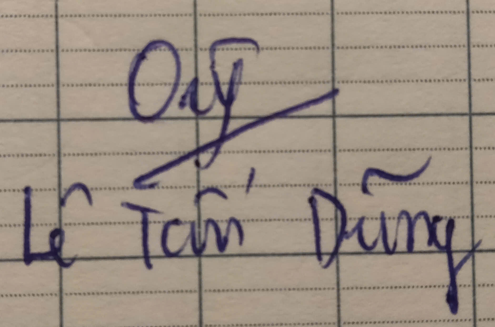
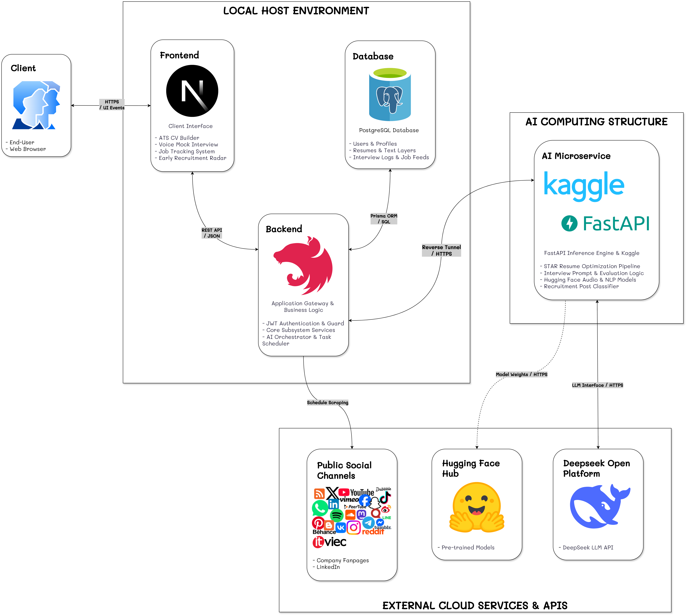

# NHẬP MÔN CÔNG NGHỆ PHẦN MỀM
## PROJECT PROPOSAL: NỀN TẢNG TỐI ƯU HỒ SƠ, MÔ PHỎNG PHỎNG VẤN KỸ THUẬT & SĂN VIỆC LÀM CHO SINH VIÊN IT (HIREUS TOOLS)

> **Môn:** Nhập môn Công nghệ Phần mềm (Introduction to Software Engineering)

> **Trường:** Đại học Khoa học Tự nhiên, ĐHQG-HCM

> **Giảng viên thực hành (GVTH):** Thầy Ngô Ngọc Đăng Khoa

> **Giảng viên lý thuyết (GVLT):** Thầy Phạm Minh Tuấn

> **Nhóm thực hiện:** Nhóm 02

> **Mô hình phát triển:** Scrum

---

## 1. BẢNG ĐÁNH GIÁ THÀNH VIÊN

| STT | MSSV | Họ và Tên | % Đóng góp (Tối đa 100%) | Chữ ký |
| :---: | :---: | :--- | :---: | :---: |
| 1 | 24120194 | **Võ Minh Khoa** | 100% |  |
| 2 | 24120249 | **Võ Nguyễn Việt Hoàng** | 100% |  |
| 3 | 24120270 | **Đỗ Chí Cao** | 100% |  |
| 4 | 24120290 | **Lê Tấn Dũng** | 100% |  |

---

## 2. PHÁT BIỂU BÀI TOÁN SƠ LƯỢC

Trong thời đại AI, sinh viên rất khó để tìm và xin được một công việc. Đặc biệt đối với ngành Công nghệ Thông tin khi AI lên ngôi, những bạn Intern hay Fresher trong mảng này thường phải cạnh tranh gay gắt và nhà tuyển dụng cũng đòi hỏi rất nhiều thứ ở ứng viên. Sau khi phân tích và làm rõ, nhóm em hiện thấy có 4 khó khăn mà các bạn sinh viên IT hay gặp phải:

* **Không biết viết CV và CV chưa đạt chuẩn:** Đa số CV sinh viên viết theo mẫu tự do, thiếu số liệu định lượng về dự án và dễ bị hệ thống tự động lọc hồ sơ ATS (Applicant Tracking System) loại bỏ rớt khỏi vòng CV.

* **Tâm lý thiếu tự tin khi tham gia phỏng vấn:** Mặc dù nắm vững kiến thức lý thuyết, nhiều sinh viên vẫn thiếu kinh nghiệm thực tế và cơ hội luyện tập với các câu hỏi phỏng vấn chuyên sâu theo hình thức 1:1, dẫn đến khả năng phản xạ và trình bày câu trả lời còn hạn chế. Bên cạnh đó, tại một số doanh nghiệp, phỏng vấn được thực hiện bằng tiếng Anh, khiến sinh viên gặp khó khăn trong việc diễn đạt ý tưởng, trình bày kiến thức chuyên môn và thể hiện năng lực của bản thân một cách rõ ràng, thuyết phục.

* **Khó tiếp cận thông tin tuyển dụng sớm:** Nhiều sinh viên mong muốn được thực tập và làm việc tại các doanh nghiệp mục tiêu nhưng lại gặp khó khăn trong việc cập nhật thông tin tuyển dụng. Các cơ hội thực tập thường được đăng tải phân tán trên nhiều nền tảng như: LinkedIn, Facebook, ITViec,... khiến thông tin dễ bị trôi hoặc bị lẫn giữa các bài đăng khác. Điều này khiến sinh viên có thể bỏ lỡ những vị trí phù hợp, các đợt tuyển dụng quan trọng hoặc những chương trình thực tập mà bản thân đang quan tâm.

* **Mơ hồ về độ phù hợp và khoảng cách kỹ năng so với thị trường việc làm:** Khi các bạn sinh viên rải hàng trăm CV và bị từ chối sau các cuộc phỏng vấn có thể là một cú sốc và các bạn không biết nguyên nhân từ đâu mà mình thất bại. Trên hết là, các bạn không biết rõ mình đang thiếu hụt kiến thức gì cụ thể để chủ động tự học và bù đắp đúng trọng tâm từ đó cải thiện mình khi đi phỏng vấn.

---

## 3. GIẢI PHÁP ĐỀ XUẤT

### 3.1. Ý tưởng & Mô hình giải pháp

#### 3.1.1. Bốn phân hệ cốt lõi

Để giải quyết trực diện 4 khó khăn thực tế đã nêu trên, nhóm đề xuất giải pháp hệ thống **HireUS Tools** gồm 4 phân hệ cốt lõi:

1. **Phân hệ 1 - Xây dựng CV chuẩn ATS & Trợ lý SeekerBot:** Cung cấp công cụ tạo và chỉnh sửa CV trực tuyến với các mẫu thiết kế chuyên nghiệp, hỗ trợ tối ưu hóa bố cục và nội dung theo tiêu chuẩn ATS nhằm tăng khả năng vượt qua vòng sàng lọc hồ sơ. Tích hợp trợ lý AI SeekerBot để hướng dẫn người dùng xây dựng nội dung CV, cải thiện cách mô tả kỹ năng, kinh nghiệm và dự án, đồng thời đưa ra các đề xuất điều chỉnh phù hợp với vị trí ứng tuyển.

2. **Phân hệ 2 - Mô phỏng phỏng vấn Kỹ thuật Giọng nói (Voice Mock Interview):** Thiết lập phòng phỏng vấn 1:1 tương tác giọng nói hai chiều thời gian thực với AI Tech Lead (hỗ trợ cả tiếng Việt và tiếng Anh), hỏi đáp linh hoạt theo ngữ cảnh và cung cấp báo cáo đánh giá chi tiết.

3. **Phân hệ 3 - Tổng hợp Việc làm & Đối sánh Năng lực (Job Matching & Skill Gap):** Bóc tách yêu cầu công việc từ Job, đối chiếu với CV của bản thân để tính điểm tương thích (%), chỉ ra chính xác các kỹ năng còn thiếu và gợi ý định hướng tự học bổ sung.

4. **Phân hệ 4 - Săn tin tuyển dụng từ mạng xã hội (Job Tracking System):** Định kỳ theo dõi các Fanpage, trang LinkedIn của các doanh nghiệp IT, tự động dùng AI sàng lọc tin phong trào để kịp thời thông báo các đợt mở đơn thực tập Intern và Fresher.

#### 3.1.2. Tình huống sử dụng thực tế

* **Tình huống 1 (Chuẩn hóa CV và luyện phỏng vấn kỹ thuật):**
  Chí Cao là sinh viên năm 3 ngành Kỹ thuật Phần mềm đang chuẩn bị ứng tuyển vị trí thực tập sinh Backend. Cao nhập thông tin dự án vào HireUS Tools và được trợ lý AI SeekerBot gợi ý viết lại phần đóng góp theo phương pháp định lượng STAR, sau đó xuất ra tệp PDF chuẩn ATS. Tiếp theo, Cao vào phòng phỏng vấn ảo, chọn vị trí Backend Fresher để luyện phản xạ trả lời câu hỏi trực tiếp bằng giọng nói với AI Tech Lead và nhận báo cáo đánh giá các lỗ hổng kiến thức sau buổi phỏng vấn.

* **Tình huống 2 (Đối soát kỹ năng và săn tin tuyển dụng sớm):**
  Việt Hoàng muốn tìm cơ hội thực tập sớm tại các công ty công nghệ lớn nhưng do bận rộn bạn không thường xuyên kiểm tra bài đăng dẫn đến bị trôi bài trên mạng xã hội. Nhờ tính năng Job Tracking System, Hoàng nhận được thông báo ngay khi Fanpage của doanh nghiệp mở đợt tuyển sinh viên. Hoàng sao chép thông tin công việc (Job) vào hệ thống để kiểm tra độ phù hợp, hệ thống báo đạt 75% điểm tương thích và chỉ rõ Hoàng còn thiếu kiến thức về Docker. Nhờ đó, Hoàng biết chính xác cần bổ sung công nghệ gì để kịp hoàn thiện trước hạn nộp hồ sơ.

#### 3.1.3. So sánh với các sản phẩm trên thị trường

| Đối thủ | Điểm mạnh | Hạn chế đối với sinh viên IT |
| :--- | :--- | :--- |
| **TopCV / VietnamWorks** | Cơ sở dữ liệu việc làm lớn, nhiều mẫu thiết kế CV đa dạng. | Mẫu CV nhiều cột đồ họa dễ bị máy quét ATS đọc lỗi, không chuyên sâu cho ngành IT, không có tính năng phỏng vấn thử nghiệm bằng giọng nói. |
| **LeetCode / HackerRank** | Kho bài tập thuật toán phong phú, chấm điểm code tự động chính xác. | Chỉ tập trung vào giải thuật thuần túy, không hỗ trợ rèn luyện kỹ năng giao tiếp phản xạ khi phỏng vấn, không hỗ trợ tạo CV hay săn việc. |
| **LinkedIn** | Mạng xã hội tuyển dụng toàn cầu với mạng lưới kết nối doanh nghiệp rộng lớn. | Thông tin quá loãng, không tự động bóc tách và phân tích khoảng cách kỹ năng (Skill Gap) theo từng Job, không lọc riêng các đợt mở đơn thực tập sớm cho sinh viên. |

#### 3.1.4. Điểm khác biệt của HireUS Tools

Ngoài các tính năng trên, HireUS Tools tập trung tối ưu riêng cho sinh viên IT đi xin thực tập (Intern) và làm Fresher, đặc biệt là sinh viên năm 3 và năm 4, giúp nhóm đối tượng này có thể xin thực tập sớm nhất, đồng thời nhận được phản hồi và gợi ý cải thiện được cá nhân hóa theo hồ sơ của từng người. Nổi bật nhất là tính năng Voice Mock Interview, một tính năng hiếm có nền tảng nào cung cấp. Ngoài ra thay vì phải lên TopCV để chỉnh CV, sang LeetCode để luyện tập và vào LinkedIn để đọc tin tuyển dụng, sinh viên có thể thực hiện tất cả trên một nền tảng tích hợp duy nhất là HireUS Tools.

### 3.2. Đặc tả kỹ thuật phần mềm

#### 3.2.1. Danh sách các chức năng phần mềm

| Nhu cầu | Yêu cầu |
| :--- | :--- |
| Là sinh viên IT, tôi muốn tạo và chỉnh sửa CV để không bị hệ thống quét loại bỏ. | **Trình tạo CV ATS** |
| Là sinh viên IT, tôi muốn AI gợi ý viết lại mô tả dự án theo chuẩn STAR để làm nổi bật năng lực kỹ thuật. | **Trợ lý SeekerBot** |
| Là sinh viên IT, tôi muốn tập luyện phỏng vấn thử 1:1 để rèn luyện phản xạ đối đáp thực tế. | **Phỏng vấn giọng nói** |
| Là sinh viên IT, tôi muốn nhận báo cáo đánh giá sau phỏng vấn để biết rõ lỗ hổng kiến thức cần ôn tập. | **Báo cáo năng lực** |
| Là sinh viên IT, tôi muốn đối chiếu CV với tin tuyển dụng để biết mức độ phù hợp trước khi ứng tuyển. | **Đối soát năng lực (Job Matching)** |
| Là sinh viên IT, tôi muốn biết các kỹ năng còn thiếu so với yêu cầu thị trường để có kế hoạch tự học bù đắp. | **Phân tích khoảng cách kỹ năng** |
| Là sinh viên IT, tôi muốn theo dõi tin tuyển dụng từ Fanpage, LinkedIn doanh nghiệp để nắm bắt cơ hội thực tập sớm. | **Theo dõi mạng xã hội (Job Tracking)** |
| Là sinh viên IT, tôi muốn hệ thống tự lọc bỏ tin phong trào nội bộ để chỉ nhận thông báo khi có đợt mở đơn thực sự. | **Lọc tin tuyển dụng bằng AI** |
| Là người dùng, tôi muốn dữ liệu cá nhân và tài khoản được bảo vệ an toàn khi sử dụng ứng dụng. | **Bảo mật & Xác thực tài khoản** |
| Là người dùng, tôi muốn hệ thống phản hồi nhanh chóng và mượt mà trong các thao tác thông thường. | **Tối ưu trải nghiệm & Phản hồi** |

---

#### 3.2.2. Kiến trúc tổng thể phần mềm

Kiến trúc phần mềm hay Tech Stack của nhóm được chọn với lý do như sau:

* **Frontend (Next.js):** Nhóm em chọn Next.js vì giao diện chạy nhanh, dùng được Web Audio API để thu âm giọng nói trực tiếp và xuất CV PDF chuẩn ATS ngay trên trình duyệt. Next.js cũng thuộc hệ sinh thái React nên tài liệu nhiều, dễ học và kịp tiến độ đồ án.

* **Backend (NestJS):** NestJS chia code theo module khá rõ ràng nên dễ bảo trì, và dễ chia việc theo từng phân hệ. NestJS dùng TypeScript giống Frontend nên cả nhóm chỉ cần học một ngôn ngữ, ngoài ra còn có sẵn Task Scheduling để chạy tác vụ cào tin định kỳ.

* **Cơ sở dữ liệu (PostgreSQL & Prisma ORM):** PostgreSQL ổn định, miễn phí và phù hợp để lưu dữ liệu có liên kết với nhau như hồ sơ, CV và lịch sử phỏng vấn. Prisma giúp kiểm soát kiểu dữ liệu và tự tạo migration, nên khi nhiều bạn cùng sửa cấu trúc database sẽ ít bị lỗi hơn.

* **Hạ tầng AI riêng (FastAPI trên Kaggle Cloud):** Nhóm em tách phần AI nặng (mô hình âm thanh Hugging Face và LLM API) ra khỏi backend chính để hệ thống không bị nghẽn, và nếu phần AI gặp lỗi thì các chức năng còn lại vẫn chạy bình thường. FastAPI nhẹ, hợp với Python nên dễ chạy các mô hình AI, đồng thời nhóm em tận dụng GPU miễn phí của Kaggle để tiết kiệm chi phí.

* **DeepSeek API & Mạng xã hội:** DeepSeek có giá rẻ, chất lượng tốt và hỗ trợ cả tiếng Việt lẫn tiếng Anh, phù hợp để tối ưu CV theo chuẩn STAR. Bên cạnh đó, hệ thống theo dõi Fanpage/LinkedIn của các công ty để báo sớm khi họ mở đơn thực tập.

---

### 3.3. Phần cứng & Hạ tầng

| Đối tượng | Yêu cầu cấu hình tối thiểu |
| :--- | :--- |
| **Phía Client (Người dùng)** | Máy tính cá nhân kết nối Internet, có microphone và loa/tai nghe (phục vụ phỏng vấn giọng nói), trình duyệt web hiện đại (Chrome, Edge, Safari). |
| **Phía Server (Vận hành hệ thống)** | CPU 4 nhân, RAM 8 GB, 20 GB ổ đĩa trống (khởi chạy trọn gói trên máy tính cá nhân qua Docker Compose). |
| **Hạ tầng AI (Kaggle Cloud)** | Môi trường đám mây hỗ trợ GPU miễn phí (Kaggle Notebooks) phục vụ chạy mô hình giọng nói và xử lý AI. |

---

## 4. KẾ HOẠCH PHÁT TRIỂN

Dự án triển khai trong 8 tuần theo mô hình **Scrum** trên **Jira**, chia thành 4 chu kỳ Sprint (2 tuần/Sprint):

| Chu kỳ Sprint | Tuần | Công việc trọng tâm | Thành phẩm cụ thể đầu ra |
| :---: | :---: | :--- | :--- |
| **Sprint 1** | **Tuần 01** | Khảo sát nhu cầu, thống nhất ý tưởng, lập Jira Backlog và hoàn thiện hồ sơ đề xuất đồ án. | - Hồ sơ Project Proposal hoàn chỉnh. - Biên bản làm việc nhóm & phân công. |
| | **Tuần 02** | Tiếp nhận góp ý từ GV, tinh chỉnh Backlog, dựng khung mã nguồn mẫu Next.js & NestJS. | - Bảng Scrum Backlog trên Jira. - Khung mã nguồn dự án trên GitHub. |
| **Sprint 2** | **Tuần 03** | Lập Use Case chi tiết, vẽ Activity & Sequence Diagram cho 4 phân hệ. | - Hồ sơ đặc tả yêu cầu phần mềm. |
| | **Tuần 04** | Thiết kế Wireframe 4 màn hình, thiết kế lược đồ cơ sở dữ liệu PostgreSQL (ERD) và danh mục REST API. | - Hồ sơ thiết kế kiến trúc phần mềm. - Bản vẽ Wireframe & kịch bản tạo CSDL. |
| **Sprint 3** | **Tuần 05** | Cài đặt Auth JWT, lập trình Phân hệ 1 (Tạo CV ATS & Trợ lý SeekerBot AI trên Kaggle). | - Module đăng ký/đăng nhập hoàn tất. - Chức năng tạo CV ATS chạy thực nghiệm. |
| | **Tuần 06** | Lập trình Phân hệ 2 (Phỏng vấn giọng nói AI hai chiều) và Phân hệ 3 (Đối soát Job & Skill Gap). | - Bản chạy thực nghiệm phỏng vấn giọng nói. - Bản chạy thực nghiệm so khớp hồ sơ và JD. |
| **Sprint 4** | **Tuần 07** | Lập trình Phân hệ 4 (Săn tin tuyển dụng mạng xã hội), tối ưu API và viết Jest Unit Tests. | - Bản chạy hệ thống quét tin tuyển dụng. - Bộ kiểm thử tự động Jest (Coverage $\ge 70\%$). |
| | **Tuần 08** | Đóng gói Docker Compose chạy cục bộ, kiểm thử tích hợp, quay video demo và slide báo cáo. | - Sản phẩm Web hoàn chỉnh chạy qua Docker. - Video demo, slide báo cáo & tài liệu cài đặt. |

---

## 5. KẾ HOẠCH NHÂN SỰ & CHI PHÍ
### 5.1. Kế hoạch Nhân sự & Phân công Vai trò trong Nhóm
Do dự án gồm 4 thành viên, mỗi thành viên đều có thế mạnh khác nhau nên các nhiệm vụ được phân công theo thế mạnh chuyên môn của từng thành viên.

| STT | Thành viên | Vai trò dự án | Nhiệm vụ kỹ thuật trọng tâm | Phân hệ phụ trách |
| :---: | :--- | :--- | :--- | :--- |
| **1** | **Lê Tấn Dũng** | Trưởng nhóm / PM & Kỹ sư AI | Quản trị dự án trên Jira, viết code dịch vụ FastAPI trên Kaggle và mở cổng API kết nối hệ thống | Phân hệ 2 (AI phỏng vấn) & Phân hệ 4 (Săn tin tuyển dụng) |
| **2** | **Võ Nguyễn Việt Hoàng** | Kỹ sư AI & Dữ liệu | Tích hợp DeepSeek API, thuật toán so khớp Job Match và mô hình phân loại tin | Phân hệ 2 (AI phỏng vấn), Phân hệ 3 (Đối soát Job) & Phân hệ 4 |
| **3** | **Võ Minh Khoa** | Lập trình viên Fullstack | Phát triển giao diện Next.js, xây dựng hệ thống API máy chủ NestJS | Phân hệ 1 (Tạo CV chuẩn ATS) & Phân hệ 3 (Đối soát Job) |
| **4** | **Đỗ Chí Cao** | Kỹ sư CSDL & Kiểm thử (QA) | Thiết kế cơ sở dữ liệu PostgreSQL và kiểm thử chất lượng hệ thống | Quản trị cơ sở dữ liệu & Kiểm thử toàn diện |

---

### 5.2. Phân bổ Công số (Man-Hours Allocation)
Nhằm đảm bảo đúng tiến độ, nhóm đề xuất định mức **8 giờ / người / tuần**. Tổng công số toàn nhóm trong 8 tuần là **256 người-giờ** (64 giờ / thành viên):
| Chu kỳ Sprint | Nội dung trọng tâm | Lê Tấn Dũng | Võ Nguyễn Việt Hoàng | Võ Minh Khoa | Đỗ Chí Cao | Tổng Sprint |
| :---: | :--- | :---: | :---: | :---: | :---: | :---: |
| **Sprint 1** *(Tuần 1 - 2)* | Khởi động, chọn đề tài & hoàn thiện proposal | 16h | 16h | 16h | 16h | **64h** |
| **Sprint 2** *(Tuần 3 - 4)* | Đặc tả yêu cầu chi tiết & thiết kế kiến trúc/CSDL | 16h | 16h | 16h | 16h | **64h** |
| **Sprint 3** *(Tuần 5 - 6)* | Cài đặt CV ATS, trợ lý SeekerBot & AI phỏng vấn | 16h | 16h | 16h | 16h | **64h** |
| **Sprint 4** *(Tuần 7 - 8)* | Cài đặt săn tin mạng xã hội, kiểm thử & đóng gói Docker | 16h | 16h | 16h | 16h | **64h** |
| **TỔNG CỘNG** | **Toàn bộ 8 tuần (4 Sprint)** | **64h** | **64h** | **64h** | **64h** | **256h** |

---

### 5.3. Kế hoạch Chi phí Cơ sở Hạ tầng & Dịch vụ Dự kiến
Hệ thống ưu tiên tận dụng hạ tầng sẵn có nhằm tối ưu chi phí:
| STT | Khoản mục chi phí | Nhà cung cấp | Cấu hình / Gói dịch vụ sử dụng | Chi phí thực tế |
| :---: | :--- | :--- | :--- | :---: |
| **1** | **Môi trường chạy Frontend** | Máy tính cục bộ | Chạy trực tiếp qua Node.js runtime (Localhost) | 0 VNĐ |
| **2** | **Môi trường chạy Backend** | Máy tính cục bộ | Đóng gói Docker Container chạy trên máy tính cá nhân | 0 VNĐ |
| **3** | **Cơ sở dữ liệu PostgreSQL** | Máy tính cục bộ | Cài đặt cục bộ hoặc khởi chạy qua Docker Compose | 0 VNĐ |
| **4** | **Hạ tầng Tính toán AI FastAPI** | Nền tảng Kaggle | Gói GPU miễn phí (30 giờ/tuần), mở cổng API | 0 VNĐ |
| **5** | **AI LLM API** | DeepSeek Open Platform | Nạp thử nghiệm gọi API token | ~ 20.000 VNĐ |
| **6** | **Mô hình AI mã nguồn mở** | Nền tảng Hugging Face | Tận dụng mô hình âm thanh và xử lý ngôn ngữ mở | 0 VNĐ |
| **7** | **Tên miền hoạt động (Domain)** | Môi trường cục bộ | Địa chỉ mạng nội bộ `localhost` | 0 VNĐ |
| **8** | **Quản trị dự án & Backlog** | Atlassian Jira | Gói Jira Software Cloud Free (tối đa 10 người) | 0 VNĐ |
| **9** | **Quản lý mã nguồn & Phối hợp** | GitHub | Gói GitHub Free (Repositories, Pull Requests, Issues) | 0 VNĐ |
| | **TỔNG CHI PHÍ THỰC TẾ** | | | **~ 20.000 VNĐ** |
