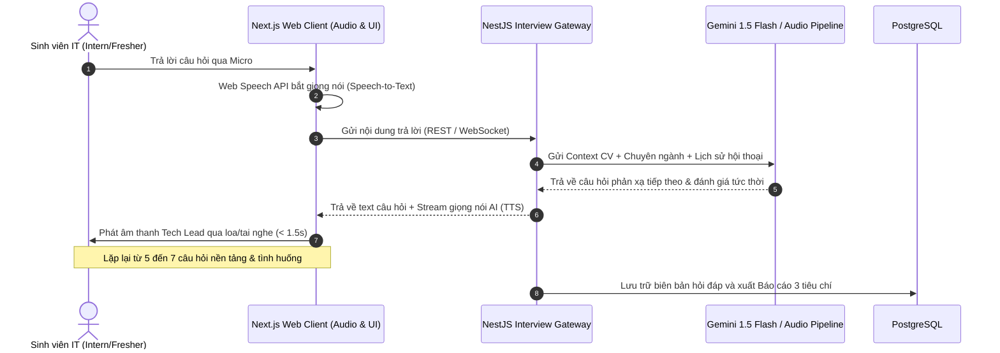
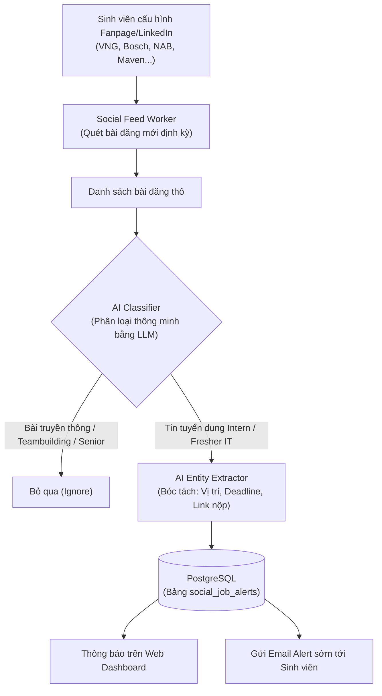
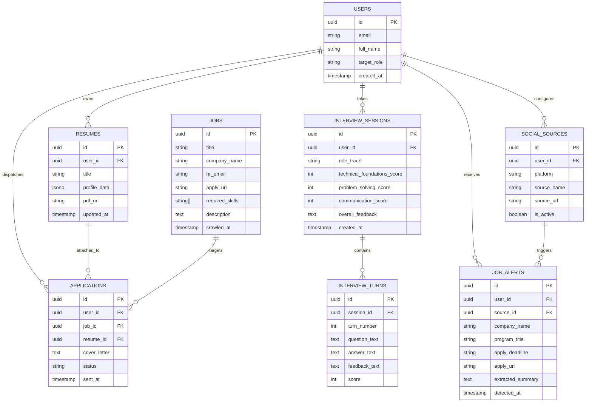

# BẢN KẾ HOẠCH TRIỂN KHAI CHI TIẾT (IMPLEMENTATION PLAN)
## DỰ ÁN: NỀN TẢNG TỐI ƯU HỒ SƠ, MÔ PHỎNG PHỎNG VẤN KỸ THUẬT & SĂN VIỆC LÀM IT (HIREUS)

> **Môn học:** Nhập môn Công nghệ Phần mềm (Introduction to Software Engineering)  
> **Trường:** Đại học Khoa học Tự nhiên, ĐHQG-HCM  
> **GVTH:** Thầy Nguyễn Ngô Duy Khoa (`nndkhoa`)  
> **Mô hình phát triển:** Scrum (Agile) trong 8 tuần  
> **Công nghệ cốt lõi:** Next.js 14 + NestJS + PostgreSQL + Google Gemini 1.5 Flash API  

---

## 1. MỤC TIÊU & PHẠM VI DỰ ÁN (PROJECT SCOPE)

### 1.1. Mục tiêu Cốt lõi
Phát triển nền tảng Web Application toàn diện giúp **sinh viên ngành Công nghệ Thông tin (IT) cấp độ Thực tập sinh (Intern) và Mới tốt nghiệp (Fresher)** (Frontend, Backend, AI/Data, Fullstack) vượt qua các rào cản lớn nhất khi tìm kiếm công việc đầu tiên:
1. Chuẩn hóa CV công nghệ theo định dạng lọc tự động ATS và phương pháp Google XYZ / STAR.
2. Luyện tập phản xạ phỏng vấn kỹ thuật 1:1 trực tiếp bằng giọng nói thời gian thực với trợ lý AI đóng vai Tech Lead.
3. Tự động hóa gửi hồ sơ ứng tuyển cá nhân hóa qua email tuyển dụng của doanh nghiệp một cách an toàn.
4. Đối sánh độ tương thích giữa CV với JD thị trường và phân tích khoảng cách kỹ năng (Skill Gap Analysis).
5. Theo dõi và dùng AI lọc thông minh các bài đăng tuyển dụng Fresher/Intern danh tiếng từ Fanpage/LinkedIn (VNG, Bosch, NAB, Maven...).

---

## 2. BỐC TÁCH CHI TIẾT 5 PHÂN HỆ KỸ THUẬT (SYSTEM MODULES)

### Phân hệ 1: CV Builder & SeekerBot (Trình tạo CV chuẩn ATS & Trợ lý Cố vấn)
- **Giao diện người dùng (Frontend - Next.js):**
  - Form nhập liệu có cấu trúc phân định rõ các phần: *Thông tin liên lạc, Kỹ năng kỹ thuật (Languages/Frameworks/Tools), Dự án tiêu biểu, Học vấn, Chứng chỉ*.
  - Khung xem trước trực tiếp (Live Preview) với layout đơn cột chuẩn ATS, font chữ chuẩn mực, loại bỏ bảng biểu phức tạp hay hình khối đồ họa gây lỗi bộ quét ATS.
  - Thanh Sidebar **SeekerBot**: Hỗ trợ ứng viên chat trực tiếp, nhận góp ý viết lại các đoạn mô tả dự án theo công thức Google XYZ (*"Accomplished [X] as measured by [Y], by doing [Z]"*).
  - Xuất bản file **PDF text layer 100%** (sử dụng thư viện `@react-pdf/renderer`).
- **Xử lý phía máy chủ (Backend - NestJS):**
  - API quản lý hồ sơ ứng viên (CRUD Resume).
  - Tích hợp Gemini 1.5 Flash API với Structured JSON Output để trả về các phân tích từ khóa kỹ thuật (Technical Keywords) và gợi ý viết lại mục dự án.

---

### Phân hệ 2: Real-time Voice AI Technical Mock Interview (Phỏng vấn Giọng nói 1:1)
- **Luồng xử lý giọng nói thời gian thực (Low-Latency Voice Pipeline):**
  1. *Ứng viên nói:* Sử dụng `Web Speech API` & `MediaStream Audio` bắt âm thanh qua microphone trên trình duyệt và chuyển thành văn bản tức thời.
  2. *AI Tech Lead phản xạ:* Backend gửi context (Chuyên ngành, Cấp độ Intern/Fresher, Lịch sử hỏi - đáp) tới Gemini API; AI đóng vai Tech Lead đưa ra câu hỏi mở hoặc hỏi xoáy (Follow-up) bám sát câu trả lời trước đó.
  3. *Phát giọng nói AI:* Chuyển câu hỏi của AI thành giọng nói tự nhiên và phát trực tiếp qua loa/tai nghe với độ trễ $< 1.5$s.
- **Báo cáo Đánh giá Năng lực theo 3 Tiêu chí Kỹ thuật:**
  1. **Kiến thức Kỹ thuật Nền tảng (Technical Foundations & Correctness):** Kiểm tra độ chính xác về lý thuyết, OOP, cấu trúc dữ liệu & giải thuật, SQL/Database, giao thức mạng và vòng đời framework.
  2. **Tư duy Phân tích & Giải quyết Vấn đề (Problem-Solving & Logical Thinking):** Khả năng tiếp cận bài toán từng bước, phân tích ưu/nhược điểm (trade-offs) và xử lý tình huống phát sinh (edge cases).
  3. **Diễn đạt Kỹ thuật & Khả năng Phản xạ (Technical Communication & Clarity):** Sử dụng đúng thuật ngữ chuyên môn (terminology), cấu trúc câu trả lời mạch lạc (What - Why - How) và phản xạ tự tin.

---

### Phân hệ 3: Automated & Assisted Job Application Dispatcher (Nộp CV Tự động)
- **Cơ chế nộp hồ sơ an toàn & hợp pháp:**
  - Không sử dụng bot headless crawler chọc vào LinkedIn/TopCV để tránh rủi ro bị khóa tài khoản hoặc dính Captcha/Cloudflare.
  - Sử dụng **Cơ chế Auto Email Dispatcher**: Hầu hết tin tuyển dụng IT Intern/Fresher đều cung cấp email HR/Tech Lead trực tiếp.
  - AI đọc bản mô tả công việc (JD) $\rightarrow$ Tự động soạn thảo **Cover Letter cá nhân hóa** làm nổi bật các kỹ năng khớp với JD $\rightarrow$ Đính kèm file PDF CV mới nhất $\rightarrow$ Gửi tự động qua giao thức SMTP (Nodemailer).
  - Bộ giới hạn tốc độ gửi (Rate Limiting) phòng ngừa spam và nhật ký theo dõi trạng thái ứng tuyển (`Audit Trail`).
- **Tiện ích Quick Apply Assistant:** Cung cấp nút mở trực tiếp link ứng tuyển trên TopCV/LinkedIn/ITviec với thông tin cá nhân đã chuẩn bị sẵn để người dùng dán vào form nhanh chóng.

---

### Phân hệ 4: Job Aggregator & Market Skills Gap Analysis Dashboard
- **Thu thập & Đối sánh Việc làm IT (Job Match Score):**
  - Background Worker định kỳ cào và chuẩn hóa tin tuyển dụng IT cho Intern/Fresher.
  - Thuật toán so khớp đối sánh các từ khóa kỹ thuật giữa CV sinh viên và yêu cầu JD theo trọng số $\rightarrow$ Hiển thị Match Score (0 - 100%).
- **Báo cáo Phân tích Khoảng cách Kỹ năng (Skill Gap Analysis):**
  - Thống kê các công nghệ mà thị trường Intern/Fresher đang có nhu cầu cao nhất (ví dụ với AI Engineer: *Python, PyTorch, LangChain, Vector DB, Git*).
  - Đối chiếu với CV hiện tại của sinh viên để chỉ ra các kỹ năng còn thiếu.
  - Đề xuất lộ trình học tập và danh mục dự án thực hành cụ thể để bù đắp khoảng trống kỹ năng trong vòng 1 - 2 tháng.

---

### Phân hệ 5: Early Career Radar & Social Job Alert (Theo dõi & Lọc tin Tuyển dụng Mạng xã hội)
- **Cơ chế vận hành:**
  1. *Cấu hình nguồn theo dõi:* Sinh viên lưu các liên kết Fanpage Facebook / LinkedIn tuyển dụng chính thức của các công ty mong muốn (VNG Careers, Bosch Global Software Vietnam, NAB Innovation Centre Vietnam, Maven, KMS...) hoặc các group cộng đồng IT.
  2. *Bộ quét dữ liệu mạng xã hội:* Worker quét các bài đăng công khai mới nhất từ các nguồn được cấu hình.
  3. *Bộ lọc thông minh bằng AI (AI Intelligent Post Classifier):*
     - Loại bỏ các bài đăng về truyền thông nội bộ, hoạt động teambuilding, chúc mừng sinh nhật, hoặc tin tuyển Senior/Manager.
     - Chỉ duyệt các bài đăng thực sự là **Chương trình tuyển dụng Intern / Fresher / Trainee / Bootcamp**.
     - Trích xuất thực thể: *Tên chương trình, Vị trí tuyển dụng, Hạn nộp hồ sơ, Link/Email nộp, Yêu cầu chính*.
  4. *Thông báo tức thời (Instant Alert):* Đẩy thông báo lên Web Dashboard của sinh viên hoặc gửi Email tóm tắt sớm để ứng viên kịp nộp hồ sơ trước hạn chót.

---

## 3. THIẾT KẾ KIẾN TRÚC & CƠ SỞ DỮ LIỆU TỔNG THỂ

### 3.1. Sơ đồ Cơ sở Dữ liệu Quan hệ (PostgreSQL Schema)

---

## 4. KẾ HOẠCH TRIỂN KHAI SCRUM 8 TUẦN (WEEKLY SPRINT TIMELINE)

| Tuần | Mốc thời gian | Giai đoạn & Nội dung công việc trọng tâm | Thành phẩm bàn giao (Deliverables) |
| :---: | :---: | :--- | :--- |
| **Week 01** | 12/10 - 18/10 | **Khởi động dự án:** Họp nhóm phân công vai trò, thiết lập 3 repo con (`FE`, `BE`, `Docs`) và repo cha, khởi tạo Jira Scrum board, thống nhất 5 phân hệ bài toán. | - Biên bản họp: `Meeting_01.md` - Không gian Jira Scrum & GitHub Repositories. |
| **Week 02** | 19/10 - 25/10 | **Đề xuất dự án (Proposal):** Hoàn thiện tài liệu Project Proposal chuẩn 5 phần, chuẩn bị bản kế hoạch chi tiết, loại bỏ văn phong AI Writing. | - `Project_Proposal.md` - `Project_Proposal.html` - `HireUS_Implementation_Plan.md`. |
| **Week 03** | 26/10 - 01/11 | **Phân tích yêu cầu (SRS):** Đặc tả chi tiết Use Cases cho 5 phân hệ, vẽ sơ đồ Use Case tổng thể, xây dựng Activity Diagrams & Sequence Diagrams cho luồng phỏng vấn và lọc tin AI. | - Tài liệu SRS hoàn chỉnh: `Software_Requirements_Specification.md`. |
| **Week 04** | 02/11 - 08/11 | **Thiết kế phần mềm (SDD):** Thiết kế kiến trúc module NestJS/Next.js, thiết kế giao diện Figma (5 màn hình chính), thiết kế CSDL PostgreSQL (ERD & Migrations). | - Tài liệu SDD hoàn chỉnh: `Software_Design_Document.md` - Bản mẫu Figma & Database Schema script. |
| **Week 05** | 09/11 - 15/11 | **Cài đặt - Sprint 1:** Khởi tạo Next.js & NestJS, Auth JWT, lập trình Phân hệ 1 (CV Builder, SeekerBot gợi ý STAR/XYZ, kết xuất PDF text layer). | - Mã nguồn Sprint 1 trên GitHub. - Module CV Builder & SeekerBot hoạt động thực tế. |
| **Week 06** | 16/11 - 22/11 | **Cài đặt - Sprint 2:** Lập trình Phân hệ 2 (Voice Mock Interview với AI Tech Lead, chấm 3 tiêu chí kỹ thuật) và Phân hệ 4 (Job Match Score & Skill Gap Analysis Dashboard). | - Mã nguồn Sprint 2 trên GitHub. - Bản chạy thử phòng phỏng vấn âm thanh & Dashboard việc làm IT. |
| **Week 07** | 23/11 - 29/11 | **Cài đặt - Sprint 3 & Kiểm thử:** Lập trình Phân hệ 3 (Auto Email Dispatcher qua SMTP) và Phân hệ 5 (Social Feed Worker & AI Classifier lọc tin VNG/Bosch). Viết Unit Test & QA kiểm thử. | - `Test_Report.md` - Bộ Test Cases (Jest) & Toàn bộ mã nguồn hoàn chỉnh. |
| **Week 08** | 30/11 - 07/12 | **Đóng gói, Triển khai & Báo cáo:** Đóng gói Docker, triển khai Vercel & Render, quay video demo tính năng, chuẩn bị slide và báo cáo nghiệm thu trước hội đồng bộ môn. | - Ứng dụng Web chạy thực tế (Production URL). - Video demo, slide báo cáo và Báo cáo tổng kết đồ án. |

---

## 5. MA TRẬN PHÂN CÔNG TRÁCH NHIỆM (RACI MATRIX)

| Hạng mục công việc trọng tâm | Lê Tấn Dũng *(Leader / AI Lead)* | Võ Nguyễn Việt Hoàng *(Frontend Dev)* | Võ Minh Khoa *(Backend Dev)* | Đỗ Chí Cao *(Database & QA)* |
| :--- | :---: | :---: | :---: | :---: |
| **Quản trị dự án, Jira Backlog & Điều phối Sprint** | **A / R** | I | I | I |
| **Soạn thảo và cập nhật tài liệu kỹ thuật môn học** | **A** | R | R | R |
| **Thiết kế UI/UX trên Figma (5 phân hệ)** | C | **A / R** | I | C |
| **Lập trình giao diện CV Builder & Audio Interview** | C | **A / R** | C | I |
| **Lập trình Dashboard Job Match & Radar Alert UI** | C | **A / R** | I | C |
| **Xây dựng API Backend & Auto Dispatcher (NestJS)** | C | I | **A / R** | C |
| **Phát triển Social Feed Worker & AI Classifier Service** | **A / R** | I | R | C |
| **Thiết kế & Tối ưu hóa Database PostgreSQL** | C | I | C | **A / R** |
| **Thiết kế Test Cases, Thực thi Kiểm thử hệ thống (QA/QC)** | I | C | C | **A / R** |
| **Đóng gói Docker, Triển khai Cloud & Tổng duyệt Demo** | **A / R** | R | R | R |

---

## 6. KẾ HOẠCH KIỂM THỬ & ĐẢM BẢO CHẤT LƯỢNG (VERIFICATION PLAN)

### 6.1. Kiểm thử Tự động (Automated Testing)
1. **Kiểm thử phân loại bài đăng AI (AI Classifier Accuracy Test):**
   - Chạy test bộ prompt phân loại trên tập dữ liệu kiểm thử (10 bài truyền thông nội bộ + 10 bài tuyển Fresher thực tế từ Fanpage VNG/Bosch).
   - Đảm bảo độ chính xác phân loại đạt $\ge 90\%$, không bị nhầm lẫn giữa tin truyền thông và tin tuyển dụng.
2. **Kiểm thử bóc tách Text của CV PDF (ATS Parsing Test):**
   - Sử dụng thư viện `pdf-parse` để kiểm tra độ trích xuất text đạt 100%, không bị tình trạng mã hóa thành hình ảnh gây lỗi bộ quét ATS.
3. **Kiểm thử độ trễ hội thoại giọng nói (Audio Latency Benchmark):**
   - Đo thời gian từ lúc ứng viên dứt lời nói đến khi AI phát câu hỏi tiếp theo đảm bảo $< 1.5$ giây.

### 6.2. Kiểm thử Thực tế (Manual Verification)
1. **Quy trình CV & SeekerBot:** Tạo hồ sơ Fresher AI Engineer $\rightarrow$ Nhờ SeekerBot sửa mô tả dự án theo chuẩn Google XYZ $\rightarrow$ Xuất file PDF $\rightarrow$ Tải lên các công cụ quét ATS trực tuyến để kiểm tra độ tương thích.
2. **Quy trình Phỏng vấn Giọng nói:** Thực hiện trọn vẹn 1 buổi phỏng vấn 5 câu hỏi qua micro $\rightarrow$ Xác nhận AI hỏi xoáy follow-up hợp lý và xuất báo cáo chấm điểm đầy đủ 3 tiêu chí kỹ thuật.
3. **Quy trình Social Job Alert:** Thêm link Fanpage tuyển dụng của VNG/Bosch $\rightarrow$ Kích hoạt quét $\rightarrow$ Xác nhận hệ thống lọc đúng tin tuyển dụng Fresher và hiển thị thông báo tức thời trên Dashboard.
